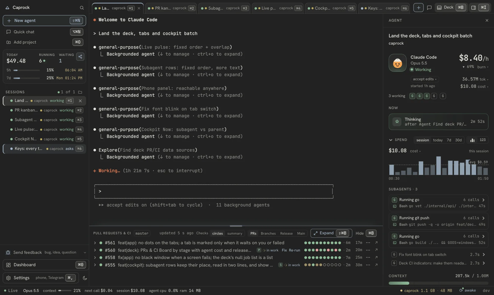
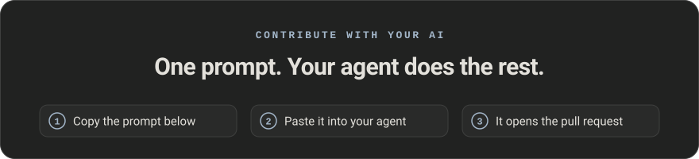
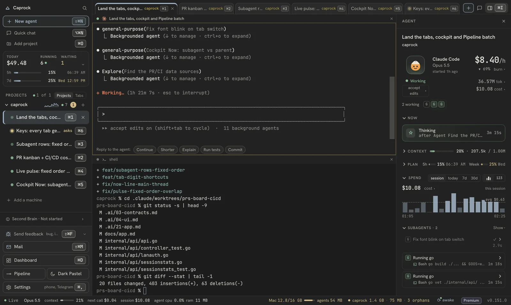
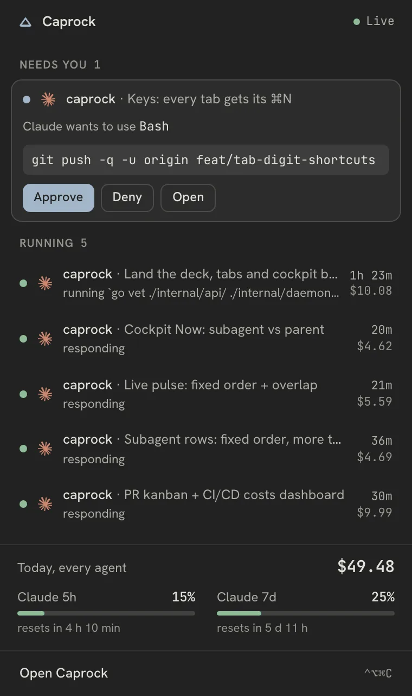
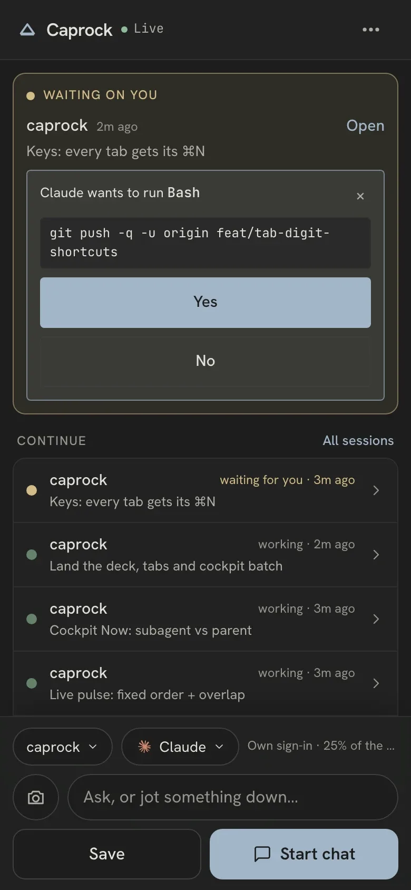
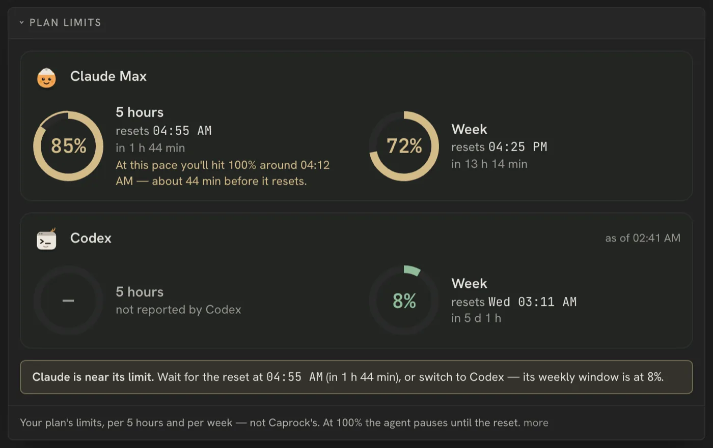
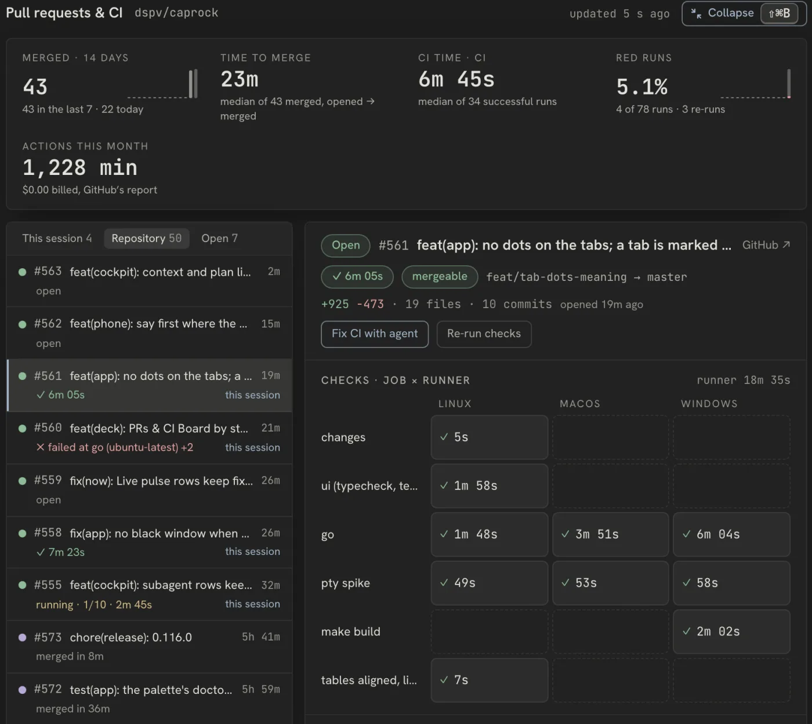
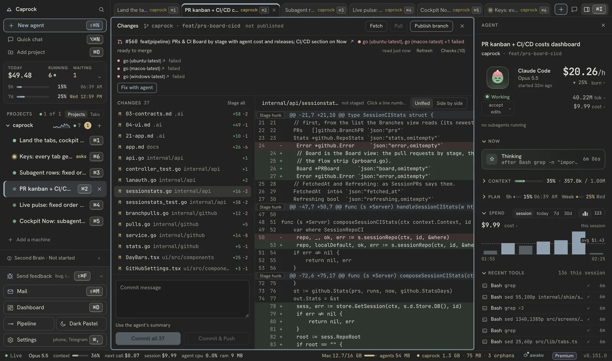
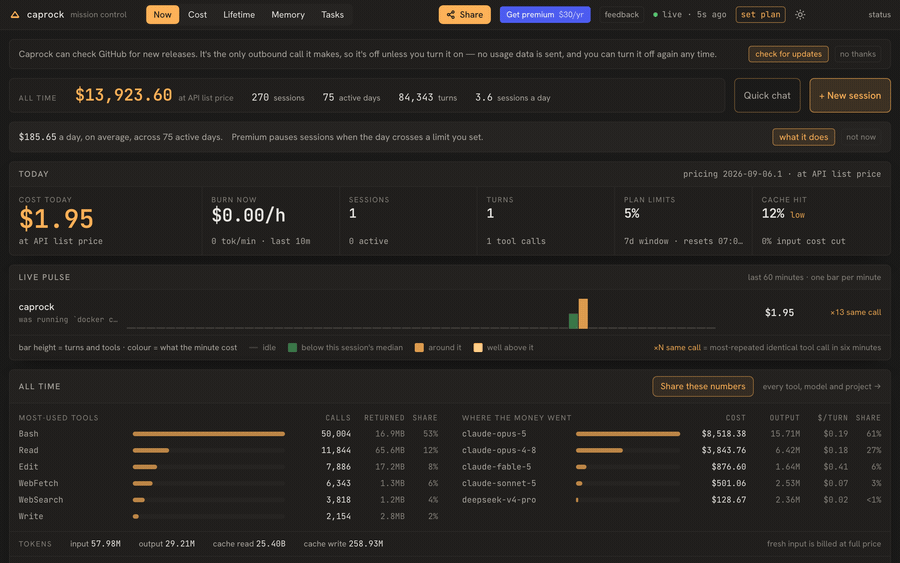
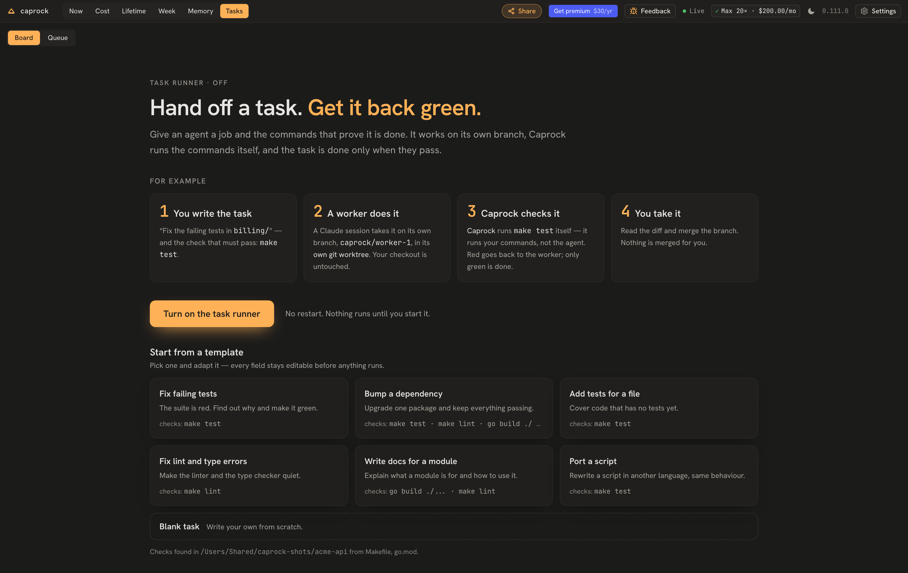

# Caprock

### Run Claude Code, Codex and OpenCode side by side — and know what every agent is doing, what it costs, and when it needs you.

A desktop app for macOS, Windows and Linux. Local, open source, no account.

```bash
brew install --cask dspv/tap/caprock-app
```

[](https://github.com/dspv/caprock/releases)
[](LICENSE)
[](https://github.com/dspv/caprock/actions/workflows/ci.yml)


<picture>
  <source media="(prefers-color-scheme: light)" srcset="docs/readme/hero-light.webp">
  
</picture>

<sub>A real Caprock work session in this repository. Example figures.</sub>

Other downloads: [macOS .dmg](https://github.com/dspv/caprock/releases/latest/download/Caprock-macOS.dmg) ·
[Windows](https://github.com/dspv/caprock/releases/latest/download/Caprock-Windows-setup.exe) ·
[.AppImage](https://github.com/dspv/caprock/releases/latest/download/Caprock-Linux.AppImage) ·
[.deb](https://github.com/dspv/caprock/releases/latest/download/Caprock-Linux.deb) ·
[.rpm](https://github.com/dspv/caprock/releases/latest/download/Caprock-Linux.rpm) ·
[the daemon on its own](#install)

<p align="center"><a href="docs/contributing-with-ai.md"><picture>
  <source media="(prefers-color-scheme: light)" srcset="docs/readme/contribute-light.svg">
  
</picture></a></p>

```text
I want to contribute to Caprock. Run `gh repo fork dspv/caprock --clone`,
then read docs/contributing-with-ai.md in the clone and follow the prompt
under "The prompt" in it, step by step. Work on the smallest open issue
labelled "good first issue" unless I name another, and tell me which.
```

Paste it into Claude Code, Codex or any coding agent, in an empty folder. It
runs every check on your machine and opens the pull request;
[how it works](docs/contributing-with-ai.md).

## Every agent in a real terminal tab

Claude Code, Codex, OpenCode and Gemini CLI in tabs and split panes, per
project and per git worktree, with a shell beside them. The sessions you start
in your own terminal show up too. Keep a work and a personal Claude Code or
Codex account side by side and pick which one each new session runs on; three
per agent are free.

<picture>
  <source media="(prefers-color-scheme: light)" srcset="docs/readme/tabs-light.webp">
  
</picture>

## Nothing waits on you unseen

Sessions stuck on a permission prompt come first. For the ones Caprock
started, answer *Yes* or *No* from the card, a notification, the menu bar or
your phone. A notification carries **Approve** only when it shows the whole
request, so you never answer a command you have not read.

<p>
  <picture>
    <source media="(prefers-color-scheme: light)" srcset="docs/readme/menubar-light.webp">
    
  </picture>
  &nbsp;
  <picture>
    <source media="(prefers-color-scheme: light)" srcset="docs/readme/phone-light.webp">
    
  </picture>
</p>

## What each repository costs, and how close the limit is

Every turn priced at API list prices, per repository and per service in a
monorepo — an estimate of what the same work would cost through the API, not a
bill. Your Claude and Codex plan windows sit beside it, with a warning before
you hit the limit.

<picture>
  <source media="(prefers-color-scheme: light)" srcset="docs/readme/limits-light.webp">
  
</picture>

## Pull requests and CI next to the agent

The deck shows the repository's pull requests with every check per job and OS,
how long they took and what the agents spent on them. A red run, a conflict or
a branch behind master gets *Fix CI with agent*, *Fix conflict with agent* or
*Update branch* from the row; the Changes view stages, commits and pushes
without leaving the window.

<picture>
  <source media="(prefers-color-scheme: light)" srcset="docs/readme/deck-light.webp">
  
</picture>

<picture>
  <source media="(prefers-color-scheme: light)" srcset="docs/readme/changes-light.webp">
  
</picture>

## And the rest

- **Your history, kept.** Every session stays searchable after Claude Code's
  30-day cleanup deletes the transcript — including what the agent wrote.
- **Runaway agents caught.** Loop alerts on repeated tool calls, and an opt-in
  task runner for Claude Code that calls a task done only when your own test
  commands pass.
- **On your phone, from anywhere.** Pair once with a QR code; an encrypted
  relay carries only ciphertext ([details](#open-it-on-your-phone)).
- **Local.** One SQLite file on your disk, loopback only. No account, no cloud,
  no telemetry.

In August the author ran [$5,898 of Claude Code on a $200 Max plan — 29× at
API list prices](https://caprock.dev/blog/claude-code-cost-per-month/), and
found out only because Caprock counted it.

## Install

Caprock is a desktop app; under it runs a local daemon that also serves a
browser dashboard, and the app bundles it.

**The desktop app** — macOS first, with Windows and Linux builds:

```bash
brew install --cask dspv/tap/caprock-app       # macOS (universal)
```

Or download the newest build directly: [macOS .dmg](https://github.com/dspv/caprock/releases/latest/download/Caprock-macOS.dmg),
[Windows installer](https://github.com/dspv/caprock/releases/latest/download/Caprock-Windows-setup.exe), Linux
[.AppImage](https://github.com/dspv/caprock/releases/latest/download/Caprock-Linux.AppImage), [.deb](https://github.com/dspv/caprock/releases/latest/download/Caprock-Linux.deb) or
[.rpm](https://github.com/dspv/caprock/releases/latest/download/Caprock-Linux.rpm) — every version is on
[Releases](https://github.com/dspv/caprock/releases). The app is
not notarized or code-signed yet; [docs/install-app.md](docs/install-app.md)
has the one-time "Open Anyway" step for the `.dmg` and SmartScreen's "Run
anyway". What is in the window, the shortcuts and the phone:
[docs/app.md](docs/app.md).

**Or the daemon and its browser dashboard** on their own:

```bash
# macOS / Linux
brew install dspv/tap/caprock

# Windows
scoop bucket add dspv https://github.com/dspv/scoop-bucket
scoop install caprock
# winget too, once Microsoft has merged the manifest for a release:
#   winget install dspv.caprock

caprock up        # opens localhost:22776; offers to set up hooks + plan-limit status line
```

Have Go? `go install github.com/dspv/caprock/cmd/caprock@latest` — the dashboard
is embedded, so it works with no Node build. No package manager? Grab a binary
from [Releases](https://github.com/dspv/caprock/releases).

<details>
<summary><b>Or let your coding agent install it</b> — paste one short prompt as a new message.</summary>

The agent runs the same install script as the button on
[caprock.dev](https://caprock.dev) and leaves Claude Code's settings alone: the
app asks you itself whether to connect it. What the script does, where things
live and how to remove them is in [docs/install-agent.md](docs/install-agent.md),
on master, beside the code it describes. Judged by
five fresh agents with no other context (2026-10-16, two Sonnet, two Haiku, one
Opus; none ran anything): four would go ahead and one would ask first, all
rating it 1–2 of 10 for looking like an injection, as the longer prompt it
replaces did. Each said it would read the script before running it, which the
prompt invites.

```text
Install the Caprock desktop app for me. It is open source (Apache-2.0), a local
app for my Claude Code sessions: https://github.com/dspv/caprock

What the install does and how to remove it:
https://github.com/dspv/caprock/blob/master/docs/install-agent.md

I'm on macOS, so it's `curl -fsSL https://caprock.dev/mac.sh | sh` — read the
script before you run it if you like. Leave my Claude Code settings alone; the
app asks me itself. Tell me when it's open.
```

On Windows the command is `irm https://caprock.dev/win.ps1 | iex`, on Linux
`curl -fsSL https://caprock.dev/linux.sh | sh`.

</details>

<details>
<summary><b>Coming from the old Python <code>caprock</code>?</b> Remove it first.</summary>

There was an earlier, unrelated Caprock on PyPI — a command-line stats tool that
read Claude Code usage from a proxy. This one is a Go binary with a dashboard and
shares nothing with it: different data, different install, same name. Remove the
old one so the two `caprock` commands don't shadow each other:

```bash
pipx uninstall caprock || pip uninstall -y caprock   # whichever you used
rm -rf ~/.caprock                                    # its old data
which caprock                                        # should now print nothing
```

Then install as above. **Nothing is lost:** this version reads the transcripts
Claude Code already writes, so your whole history appears on first run — no
migration, no import. (Only `~/.caprock/savings.jsonl` from the old tool is
dropped; copy it elsewhere first if you want to keep those numbers.)

</details>
On first run `caprock up` asks before adding its hook and status-line entries to
`~/.claude/settings.json` (it backs the file up and never touches your other
settings). Say no and it still reads your history from transcripts.

Run [OpenCode](https://github.com/anomalyco/opencode),
[Codex](https://developers.openai.com/codex),
[DeepSeek Harness](https://github.com/deepseek-ai/DeepSeek-Harness),
[Hermes Agent](https://github.com/NousResearch/hermes-agent) or
[Gemini CLI](https://github.com/google-gemini/gemini-cli) too? All are shown on
the same screens — OpenCode and Hermes Agent from their own databases, Codex
and DeepSeek Harness from the transcripts they write, Gemini through the
telemetry it writes when Caprock starts it. See
[OpenCode, Codex and DeepSeek Harness](#opencode-codex-and-deepseek-harness) and
[Hermes Agent](#hermes-agent) for what that covers and what it does not.

Caprock starts Codex, OpenCode (1 or 2, whichever `opencode --version`
says is installed), Gemini CLI and Hermes Agent sessions too: whichever of them
is installed appears next to Claude Code in the New Session dialog — same
terminal, same directory picker, its own filter chip — and the dialog remembers
the one you picked last. A Codex or OpenCode session started here shows its
cost and answers on the same page as its terminal, and one that has ended can
be continued with "continue here". "Continue in…" on any session starts a new
one in the agent of your choice with a summary you read first — what the agent
last said, what changed in the folder, the PRs it opened. For Gemini, install
the CLI
(`npm install -g @google/gemini-cli`).
With a Gemini key set (see [Premium](#premium) for where), Caprock passes it to
the child process. Gemini has no hooks and writes no transcript, but it does
write OpenTelemetry, and Caprock asks it to write that to a file it then reads;
what you ask it is kept there too, so the Memory screen can find a Gemini
session by your question. Starting and watching Gemini sessions is free, like
every other agent.

## The desktop app

The app opens on your terminals, not on charts. Each project in the sidebar
opens to its worktrees and the agent sessions and shells in each, with its
branch, today's cost and a dot for what every session is doing; whatever is
waiting on you sits at the top. ⌘T opens a shell, ⇧⌘N an agent, ⌘O adds,
creates or clones a project. Tabs come back when you reopen it, and closing
one never stops its session. An agent's tab switches between its terminal
and a chat view of the same conversation.

Outside the window: the menu bar shows your plan limits, today's spend and
the sessions waiting for approval; the Dock badge counts them; ⌃⌥⌘C brings
the window up from anywhere. When an agent stops on a permission prompt, a
macOS notification carries **Approve** and **Deny** — Approve only when the
notification shows the whole request, so you never answer a command you have
not read. Every dashboard screen below is inside it too.

The whole tour is in [docs/app.md](docs/app.md). Voice mode says "No audio
detected from microphone"? See
[Voice mode and the microphone](docs/app.md#voice-mode-and-the-microphone).

## Your numbers, ready to publish

`caprock report` prints what your captured usage comes to at API list prices,
in a form you can paste somewhere. When the total includes Codex, Gemini or
DeepSeek turns, the caveat names every vendor whose list was used and the
headline stops calling it all Claude Code:

```bash
caprock report              # a block for a post
caprock report --markdown   # the same facts as a table
caprock report --json       # machine-readable
```

```
$9,704 of Claude Code at API list prices on a $200/month plan — 41.6× the fee.
Priced from captured tokens at Anthropic list prices — what the same work would
have cost through the API. Not a bill, not a discount received, and not money
back: without the plan I would not have run this much.

2026-07-19 → 2026-08-22 · 33 active days
paid $233.33 over that window · same usage at API list $9,704
59,578 turns · 57 sessions · 26 projects
99% cache hit · 89% of input cost cut by cache
15,701,665,082 tokens read from cache · 128,597 fresh input
```

The caveat is part of the output, on every shape, because the number is not a
bill and not money saved — it is what the same work would have cost through the
API, and it is quotable enough to be worth making hard to quote without that.
The multiple compares your usage against the plan fee **for the window that was
measured**, so the report also prints the fee it divided by, with cents, so the
division checks out on sight. The raw token counts sit under the cache
percentages: they are what those percentages are computed from, and they are the
half of the cache story a reader can picture. Set your plan in
the dashboard header first; with no plan stated, `caprock report` says so and
shows no multiple rather than guessing one.

It reads from the running daemon and only issues GETs. Numbers move as you work,
so re-running it is the point — a figure you pasted last month is a figure about
last month.

## Is it Caprock?

`caprock doctor` prints what Caprock itself costs your machine — memory and
CPU of the daemon, the app and its window, and the terminal holders; the data
directory on disk; the daemon's own disk reads and writes — and flags a second
daemon, a second app, orphaned terminals and an oversized database. It works
with no daemon running and exits 1 when something is flagged. Orphaned idle
terminals and an oversized write-ahead log are cleaned up on their own, and the
report says when. Details: [docs/doctor.md](docs/doctor.md).

## Take the record out

Every agent Caprock reads — Claude Code, Codex, OpenCode, Gemini CLI, DeepSeek, Hermes —
lands in the same tables with the same columns. `caprock export` writes one of
them out, for a spreadsheet, a notebook or your own warehouse:

```bash
caprock export --since 30d > events.tsv           # one row per turn and tool call
caprock export sessions --format csv --out s.csv  # one row per session
caprock export --agent codex --format jsonl       # one agent, as JSON lines
```

It reads the database read-only, so it works with the daemon stopped. The
columns, what each agent's source maps to, and what is deliberately left out are
in [`docs/schema.md`](docs/schema.md). The record also outlives the agents' own:
Claude Code removes its transcripts after 30 days by default, and Caprock
keeps what it read from them.

A session you do not want counted — a test run, say — comes out with *Remove
from Caprock* on its page, or in bulk from the terminal. It lists first and
removes only with `--yes`; a removed session is never read back in:

```bash
caprock sessions rm --cwd-prefix /private/tmp/scratch        # what would go, and its cost
caprock sessions rm --cwd-prefix /private/tmp/scratch --yes  # remove them
```

## What it is

Claude Code runs in a terminal. Caprock is the app that terminal lives in,
and the window into what it does. One local daemon, with an app and a browser
dashboard on top. Your data never leaves your machine.

**What that database holds.** Everything Claude Code read and wrote: your
prompts, its replies, and the full output of every tool call. That output is
where secrets end up — an API key printed by a command, a token in a `.env`
file that got read. The file is `0600` and nothing sends it anywhere, but it
is inside your backups, so treat it as you would your shell history: do not
put it in a bug report, and do not hand it to anyone debugging an issue for
you. `caprock down` and deleting the data directory removes all of it.

## What your context is costing you



Every call re-sends the whole conversation before it does anything. You pay for
that on every call, and it grows as the session does — so the 300th call in a
long session costs real money before it has run.

Caprock puts the price where you are already looking. A running session says
what its **next call** costs at the context it is carrying. The lifetime
breakdown says what that has come to. On the machine this was recorded on, it
is 79% of the bill.

The number is exact, not modelled: the context of every call comes from the
token counts Claude Code itself records, priced per model from the pricing
table. Calls that arrive without a way to attach them to the turn that paid for
them are excluded and counted, so a figure is never quietly short.

## OpenCode, Codex and DeepSeek Harness

Caprock also reads [OpenCode](https://github.com/anomalyco/opencode),
[Codex](https://developers.openai.com/codex) and
[DeepSeek Harness](https://github.com/deepseek-ai/DeepSeek-Harness) sessions, on
the same screens as Claude Code. A machine that runs more than one has its spend
split across tools that each see part of it; here the projects list, the history
and the cost add up over all of them, and the rows carry each agent's own mark
so you can still tell them apart.

**Or see one at a time.** The Home screen carries
`all / claude / opencode / gemini / codex / deepseek / hermes` in the middle of its
header, and it applies to the whole screen — today's totals, the live pulse, the
activity feed, the projects list and the session cards all answer the same
question. It appears only on a machine that runs more than one.

Nothing to configure for any of them. OpenCode is found through its own
database, opened read-only — OpenCode 1 and OpenCode 2 alike, including a
database OpenCode 2 migrated from 1, where each session is counted once; Codex through the transcript it writes per session,
under `$CODEX_HOME` (or `~/.codex`), archived sessions included; DeepSeek
Harness through the transcript it writes per session. No shim, no
settings file to edit, and sessions from before you installed Caprock are
included, because each tool keeps its own history. What OpenCode, Codex and
DeepSeek Harness wrote back is searchable on the Memory screen beside Claude's.

**The cost works differently for each, and it matters.** OpenCode computes its
own figures and Caprock passes them through, so they match what OpenCode
reports. Codex reports how many tokens a turn used but never what it cost, so
those are priced from Caprock's own table of OpenAI list prices. Like every
number here, both are modelled from list prices, not a bill.

Three things about Codex figures worth knowing:

- A turn whose transcript does not name the model it ran on keeps its tokens and
  shows **no cost**, rather than a guessed one. `caprock status` reports how many.
- About half of Codex's token reports give a total without breaking it down by
  kind. Caprock counts that total as input, which is the unqualified rate — so
  for those turns the cost is an **upper bound**: any part of it that was really
  a cached read cost a tenth or less of what is shown.
- OpenAI bills the gpt-6 models for writing to their cache, at 1.25x input, but
  Codex does not report how many tokens were written. Those arrive as plain
  input, so a gpt-6 figure can be low by up to a quarter of that unreported
  share.

**Codex's plan limits** sit on the Cost screen under Claude Code's, labelled as
Codex's: the 5-hour and weekly windows as Codex last wrote them into a session
transcript, with the time it wrote them. Which windows appear depends on the
plan — some ChatGPT plans have no 5-hour window. They are shown as measured and
never forecast.

**What is not there yet.** Caprock starts, types into and stops the Codex and
OpenCode sessions it started, in terminal tabs; DeepSeek Harness is read only,
and the task runner works with Claude Code alone. A session started outside
Caprock refreshes every few seconds rather than instantly, so the Home screen
lags a little behind it — the Cost and Lifetime screens are unaffected. Verified on macOS; it builds and its tests pass on Linux and
Windows, but it has not been run on either.

### Hermes Agent

Caprock reads [Hermes Agent](https://github.com/NousResearch/hermes-agent)'s
own database (`~/.hermes/state.db`), read-only, and starts Hermes in a
terminal tab from **New agent**. Every Hermes session — its CLI and TUI, and
the cron jobs and gateway chats that run with nobody watching — is on the same
screens, with Hermes's own cost figures, never re-priced: the Cost screen says
which part the provider reported and which part is Hermes's estimate, and
shows background runs apart, by source. Delegated subagents sit inside the
session that delegated them, counted once. Nothing is installed into Hermes.
Only Hermes's default profile is read. See [docs/hermes.md](docs/hermes.md).

### Claude Code on DeepSeek

Caprock can also start Claude Code itself on DeepSeek's models, on your own
DeepSeek API key — free. Paste the key in Settings → *Subscriptions*, under
Claude Code; *New agent* and *Quick chat* then offer **DeepSeek · your API
key** in their *Subscription* picker. A session started on it runs in your
usual Claude Code setup, with DeepSeek's
[documented variables](https://api-docs.deepseek.com/quick_start/agent_integrations/claude_code)
and your key set for that one process, so its model calls go to
`api.deepseek.com` instead of Anthropic and DeepSeek bills your key; your
claude.ai sign-in is not used and its plan limits do not apply.

- **What leaves the machine.** The session sends DeepSeek what Claude Code
  would otherwise send Anthropic: your prompts, the files it reads and tool
  output. Caprock itself sends nothing, and the key goes into that session's
  environment only — never its command line, the database or a log. *Remove
  key* in Settings takes it away for every new session.
- **What you see.** The session's card says *DeepSeek*, its model is
  DeepSeek's, and its cost is priced at DeepSeek Flash's off-peak list price
  (DeepSeek bills double in its weekday peak hours, so those turns read low).
  It is never counted against your Claude plan's 5-hour or weekly window.
- **Model.** Every session runs on DeepSeek Flash; the launcher's Claude
  model choice does not apply to it.
- **Not yet verified** against a funded DeepSeek account: the endpoint, the
  key and Claude Code's routing were checked live, but the model name
  DeepSeek reports back has not been seen, so if it is not `deepseek-flash`
  those turns show as unpriced rather than mispriced.

## Why

- **See it** — live activity, tokens, cost, and loop alerts per session, plus
  what each repository costs you and who is working in it.
- **Find what Claude said** — the reasoning and the "here's what changed, here's
  what I still need from you" that otherwise lives only in terminal scrollback,
  searchable across every session.
- **Keep what matters** — Second Brain: drop an answer, or a line of your own,
  into a graph of ideas, decisions and findings, each linked to its project,
  its topics and the moment in the session it came from — or let your own
  `claude` build it from finished sessions, once you say yes. Free.
  Kept on this machine.
- **Pick up where you left off** — a new session in a folder you have worked in
  is handed the last thing the previous one said there (on by default, off in
  settings). You can measure whether that helps: an opt-in setting holds it back
  from one new session in four and the Memory screen compares the two.
- **See what it went on** — not just which model or which repository, but what
  the money was doing: running commands, writing code, reading and searching, or
  turns that called no tool at all.
- **Know what it's worth** — your measured usage priced at the API rate, against
  what your plan actually costs.
- **1-click terminal** — the Terminal button on a project opens the session
  Caprock is running there, picks up one started elsewhere, or starts a new one.
  A running card on Home opens in its terminal too. Session pages and projects
  link to the repository and the pull requests a session opened.
- **Steer it** — spawn, pause, and kill sessions from the dashboard, and continue
  one that has ended. Each card says what the session was about and when it was
  worked in, says why when it cannot be continued, and ended sessions are
  searchable. After a reboot the Home screen lists the sessions it interrupted,
  each with continue.
- **Trust it** — an opt-in task runner whose tasks finish only when the checks
  Caprock runs come back green.
- **Local-first** — loopback only, no servers, no telemetry, no account. Nothing
  reaches the network unless you switch it on: the release check, the Gemini
  chat on your own key, GitHub, and the weekly report, alerts and chat through
  your own Telegram bot are each off by default. Caprock may ask you about
  a feature it is considering; your answer reaches caprock.dev only if you
  press Send, and the card says exactly what it sends. A bug report you write
  in Caprock goes privately to Caprock support at caprock.dev, not GitHub,
  only when you press Send to support, and the sheet lists what it sends.

What your usage is actually worth — the same work priced at the API rate,
against what your plan costs — is on the Cost screen, and everything you have
ever run through it on Lifetime: measured, not estimated.

## How it works

- **Observe** — watches every `claude` session via hooks + transcripts, and
  draws the last hour as a pulse: bar height is how much happened that minute,
  colour is what it cost.
- **Control** — run and drive sessions from the browser. When a session is
  waiting on you, **what did it ask?** shows the last thing Claude said without
  a trip to the terminal.
- **Orchestrate** — run queued tasks unattended, with a test gate; a task is done
  only when green. Opt-in, off by default — see below.

Nothing to change in your workflow — it starts by watching the sessions you already run.

## Run tasks unattended (advanced, opt-in)



This is the one part of Caprock that starts sessions on its own, so it is off
unless you ask for it. Turn it on from the Tasks screen — the button creates the
queue directory and starts the board without restarting the daemon. The honest description is **an unattended task runner
with a test gate**: the closest thing you already know is a git worktree plus a
shell loop. What it adds is that a worker cannot stop early, a failing check
bounces back with its output attached, spend is attributed per task against a
budget, and there is a board showing where everything is.

```bash
caprock up --hive ~/caprock-tasks --repo ~/dev/myproject
```

`--hive` is a queue directory; Caprock creates it, and seeds it with a README
showing the task format so it explains itself; the queue starts empty. `--repo` is the checkout the work
happens in (default: the current directory). Your own working tree is never
touched — each worker gets its **own git worktree** at
`<repo>/.caprock-worktrees/<worker-id>`, on a branch named
`caprock/<worker-id>`.

```
~/caprock-tasks/
├── README.md              # what this directory is
├── tasks/<id>.md          # one file per task — the source of truth
├── agents/<id>/           # identity, memory, inbox/, outbox/
├── approvals/             # decisions waiting on you
├── verifications/         # captured output of every check that ran
└── ledger.jsonl           # append-only log of every state change
```

A task is a markdown file with YAML front matter. This is a complete one:

```yaml
---
id: t-healthz
title: Add a /healthz endpoint
status: inbox
assignee: null
budget_usd: 3
done_criteria:
  - go test ./...
  - go vet ./...
verify_rounds_used: 0
---
Add a GET /healthz returning 200 and {"status":"ok"}. Cover it with a test in
the existing handler test file.
```

Create one from the dashboard's Tasks screen, or from a terminal:

```bash
caprock task create --title "Add a /healthz endpoint" \
  --done-criteria "go test ./..." --done-criteria "go vet ./..." --budget 3
caprock tasks          # the board
caprock status         # includes which hive is in force
```

Then press **Start orchestrator** on the Tasks screen. Nothing runs until you
do.

### What `done_criteria` is

Plain shell commands. When a worker reports it has finished, **Caprock** runs
them — not the agent — in that worker's worktree, with a five-minute ceiling
each. Every command exits 0 and the task moves to `done`. Any command fails and
the output bounces straight back to the worker to try again; after three rounds
it stops and asks you. A task with no `done_criteria` cannot be verified, so it
is never marked done on a worker's say-so.

They run in a real checkout of your repository, so treat them as commands you
are running yourself: `go build ./...` will leave a binary behind exactly as it
would in your own tree.

### Before you turn it on

- **Workers run with permission prompts skipped** (`--dangerously-skip-permissions`),
  in a worktree of your repo. A task body is acted on without a further
  confirmation from you. Give each task a budget.
- **Only for independent tasks.** Nothing here merges branches, and nothing
  notices two workers editing the same file. Give concurrent tasks separate
  ground.
- **You land the work.** When a task is done, open its card: it shows the diff,
  the checks that passed, the branch, and the git command that merges it. Caprock
  never writes to your branches itself.

Found a bug, or something that did not explain itself? The **feedback** button
in the header opens a prefilled GitHub issue in your browser — nothing is sent
from the dashboard, and what gets attached is on screen before you press it.

## Premium

Everything above is free, Apache-2.0, and stays that way — including the cost
of every provider Caprock can see, Anthropic or not.

Premium adds the things that act on what you are looking at.

**A daily cap.** Pass a number you set, and Caprock pauses the sessions it
started — paused, not killed, and never a session you started yourself. Built.

**A stop at the plan limit.** On Pro or Max, what runs out is Claude's 5-hour
or weekly window, not dollars. When either passes the share you pick in
Settings (90% until you change it; or off), Caprock pauses the Claude Code
sessions it started, names them in a notice with the reset time, and resumes
them after the window resets — nobody has to type "continue". Resume one
yourself and it is left alone until the next window. Sessions you started
yourself are never touched, and Caprock never pauses on figures more than ten
minutes old. The figures come from Caprock's status line
(`caprock statusline install`). Without Premium the 90% alert on Home stays as
it is.

**Ask Gemini about your numbers, on your own key.** A second model inside
Caprock, billed to you by Google at their prices. Get a key from
[Google AI Studio](https://aistudio.google.com/apikey) and either export
`GEMINI_API_KEY` before `caprock up`, or paste it into the field on the Cost
screen. An exported variable wins; a pasted key is written to the config file
with owner-only permissions and never leaves the machine or comes back out of
the API.

On the Cost screen, a question carries today's and
the week's spend, top projects and models — so the answers are about your
machine; your prompts, replies, and tool output are never sent. A question costs
about 0.04 cents on Flash Lite and 1 cent on Pro, priced before you spend it.
Built.

**A weekly report** of what moved — spend, the projects that drove it, and
what changed against the median of the last four weeks — sent to your own
Telegram bot.

**Where each tool failed.** On Lifetime a tool's row opens into its calls
grouped by what they were about — Bash by command, Read and Edit by file,
WebFetch by domain — and that much is free. Output, failure rate and a trend
per group are Premium; without a licence the daemon leaves those figures out.

**More subscriptions.** Three Claude Code and three Codex sign-ins are free,
your own included; Premium adds as many more as you use.

$30/year or $100 once — [caprock.dev/premium](https://caprock.dev/premium/).

A key arrives by email and goes in the dashboard's settings, or:

```bash
caprock license set YOUR-KEY      # the key from the email
caprock license                 # what is in force
```

The key carries its own expiry and is checked on your machine. Caprock makes no
request to us to verify it, now or ever — there is nothing to verify against.
Paid features keep working for seven days after a key expires, so a late
renewal does not interrupt you.

## Updating

Use the command that matches how you installed it:

```bash
brew update && brew upgrade caprock                     # Homebrew
scoop update caprock                                    # Scoop
brew upgrade --cask caprock-app                         # the desktop app (macOS)
go install github.com/dspv/caprock/cmd/caprock@latest   # go install
```

The desktop app updates itself: when a newer release is out, its status strip
offers **Update to vX.Y.Z — Restart**, and sessions, tabs and splits come back
as they were ([docs/app.md § Updates](docs/app.md#updates)). An app from before
that button existed needs the command above, or the new `.dmg`, once.

`brew update` first is not decoration: a tap is read from a local git clone
that `brew upgrade` refreshes only through auto-update, which runs at most once
a day. Without it, Homebrew can report `already installed` for a release that
has been public for hours.

Then restart the daemon so the new binary is the one running:

```bash
caprock down && caprock up
```

`caprock down` stops the daemon and leaves your database alone — nothing is
lost, and history from before the upgrade stays exactly where it was. Check
what you ended up on with `caprock status`.

Sessions you started from the dashboard keep running through the restart: each
one's terminal lives in a small process of its own, and the new daemon picks it
back up, screen and all. If autostart is installed, run `caprock service
install` once after upgrading so its file carries the settings that let
sessions outlive a service restart (`caprock service status` tells you when it
differs).

Caprock can also tell you when a release is out: turn on release checks from
the banner on the Home screen, or under Privacy in settings. That is the only outbound
call it makes, it is off until you switch it on, and it sends nothing about
you. It never installs anything by itself — it shows the one command above for
your install method, and you run it.

Downloaded the binary directly? Replace it with a fresh one from
[Releases](https://github.com/dspv/caprock/releases) and restart.

## Open it on your phone

Caprock answers only the machine it runs on. A phone reaches it **from
anywhere**, through an encrypted relay — on the home Wi-Fi and on mobile data
alike, with nothing to install on the phone.

### From anywhere, through an encrypted relay

For a phone on mobile data, a laptop at home, a Mac mini in a cupboard
running agents:

1. In the Caprock app on the computer: **Settings → Use on your phone**.
   Leave **This phone can type and start agents** ticked (the default) for a
   phone that should work on sessions; untick it for one that should only
   look.
2. Press **Show a code**. That press is what turns access from anywhere on,
   and it stays on until you turn it off. Over SSH, `caprock remote on` then
   `caprock pair` (which draws the QR in the terminal) do the same, for a
   phone that only looks.
3. Point the phone's camera at the code and open the link. The phone pairs
   and says it is ready: connected, and whether it can type. The panel on the
   computer ticks off the same list as it happens.
4. Optional: install the app. An iPhone keeps a home-screen app's storage
   apart from Safari's, so paste the link there once: *Copy link* under the
   code, then *+ Add a machine* on the phone.

Each paired device in Settings says how it reaches the computer: *anywhere*,
or *Wi-Fi link* for a phone paired on a home-network address before this was
the one way. A Wi-Fi link works on that Wi-Fi only; the row offers **Show the
code** to pair it once more through the relay, and the phone itself says the
same while it is on that link.

The phone can hold several machines and switch between them from the strip
along its top. It stays on across restarts until you turn it off.

How it works, and what it means for your data: your computer opens a
connection out to a relay (`wss://relay.caprock.dev`, or one of your own),
the phone connects to the same relay, and the relay passes bytes between them.
Those bytes are encrypted end to end with a key the phone read from the QR
code (Noise NK, X25519, AES-GCM), so the relay cannot read a session, a token
or a command, and cannot alter them without the phone hanging up. What the
relay does see is which machine a phone connects to, when, from which IP
address, and how many bytes pass; it stores nothing. The same pairing, device
tokens, viewer and controller roles apply as on the LAN, below.

To run your own relay, put `caprock remote relay --addr 127.0.0.1:8787`
behind TLS and point the machine at it: `caprock remote on --relay
wss://your.relay`. The phone's page can be yours too: build it with
`cd ui && npx vite build --mode remote`, serve `ui/dist-remote/` over https,
and add `--app https://your.page`. `relay/` holds the hosted relay, a
Cloudflare Worker, and `relay/m/` the hosted page at m.caprock.dev.

### From another of your computers

One Caprock can work on another's sessions — a MacBook on the agents running
on a Mac mini — through the same encrypted relay, chosen by the computer
being reached. From a terminal on each:

1. On the computer to be reached (over SSH is fine): `caprock pair
   --computer`. It turns access from anywhere on if it is off and prints a
   link, valid five minutes, once.
2. On the other computer: `caprock machines add '<that link>'`.
3. Back on the first, allow it by name: answer the question in the terminal
   that printed the link, press **Allow** on the card its screen shows, or
   run `caprock machines allow <name>`. Until then it reaches nothing.

In the app it is the same, with fewer commands: **Settings → Computers**
takes the pasted link and lists the steps for the other computer; with no
computer linked yet, the sidebar's **+ Add a machine** opens it. Once a
computer is allowed, the sidebar lists the sessions running on it, tagged by
its name, and opens one — its conversation and its terminal — through this
Caprock. Starting a session there from the app comes next; for now start it
on that computer, or over SSH.

An allowed computer can start, type into and stop sessions there, open shells
and run tasks — never that computer's settings, pairing, updates or the
doctor's stop, and only the sessions that computer's Caprock started. Pairing
is one way: reaching back is a second pairing. `caprock machines` lists both
directions; `caprock machines revoke <name>` on the reached computer, or
**Remove** in its Settings, ends it at once, open terminals included;
`caprock machines forget <name>` on the other drops it from both. On Linux, a
computer that should stay reachable with nobody logged in needs `loginctl
enable-linger <user>` once; `caprock service install` and `caprock pair
--computer` say so when it is off.

### Without internet: on the same network (advanced)

The app no longer offers this — a link that works on one Wi-Fi only left a
phone dead on mobile data with nothing saying why. It is still there from a
terminal, for a machine with no way out to the internet:

1. `caprock up --lan` listens on this machine's private Wi-Fi address too
   (and its Tailscale one, when Tailscale is up). With access from anywhere
   off, `caprock pair` then draws a QR for that address, with the six digits
   to type on a phone without a camera.
2. The phone, on the same Wi-Fi (or on Tailscale, which also works from
   mobile data), opens the address and pairs. It appears in Settings under
   *Paired devices* as a *Wi-Fi link*, with a *Remove* button; while that
   listener is on, Settings shows it with a *Turn off*.

The QR code is drawn locally; nothing is sent anywhere to make it.

**Put it on the home screen.** On an iPhone, Share → *Add to Home Screen*; on
Android, Chrome's menu → *Add to Home screen*. It opens full-screen with the
Caprock icon, in your light or dark theme, clear of the notch. An iPhone keeps
a home-screen app's storage apart from Safari's, so the first time you open it
from there it asks to pair again: press *Show a code* on the computer and type
the six digits (scanning would open Safari, not the app). The machine lists it
as a second device, "iPhone · home screen".

Over a plain `http://` address — your Wi-Fi or a Tailscale `100.x` address —
the browser treats the page as not secure, which costs three things and
nothing you need to work:

- **No offline copy.** Caprock registers no service worker, on purpose: every
  figure is live and must never come from a cache. Without the computer, the
  app shows nothing rather than something stale.
- **Android adds a shortcut, not an installed app.** Chrome installs a web app
  only over HTTPS; *Add to Home screen* still works and opens Caprock.
- **No push notifications.** Web Push needs HTTPS (and, on an iPhone, the
  home-screen app). Alerts that a session needs you go through your own
  Telegram bot instead (Settings → *Phone alerts*, ADR-036).

That is the whole setup — no account, no tunnel, nothing on anybody's server.
The other device is talking to your machine.

A few things worth knowing about the network listener, because it is the one
place Caprock stops being loopback-only:

- **Nothing gets in without pairing.** Every request from the network is
  refused until a device has traded a code for a token. Devices are listed in
  settings and can be removed one by one, which takes effect on the next
  request.
- **A paired device reads, unless you let it control sessions.** It sees
  sessions, costs, answers, changes and the task board. *This phone can type
  and start agents*, ticked beside *Show a code* (the default), or *Let it
  control sessions* beside a device afterwards, lets that phone also start a session in
  any folder under your home directory with Claude Code, Codex or OpenCode, in
  any permission mode (Bypass asks once first, and the computer's one-time
  bypass consent has to have been given at the computer), type into it (a big input
  field plus Esc, Tab, arrows, Enter and Ctrl+C buttons; `/` and `@` pick a
  command or a file, and a message sent while the agent works waits in a queue
  the computer holds and goes in when the turn ends), answer approvals and
  stop it. *Start work* on Home also lets it clone a repository, make a new
  project or a worktree, and start an agent there, opening on the session's
  chat. It can start a plain chat in one tap, with no folder to pick, and
  archive or delete chats. That is as much power as a shell in your home directory, so grant it
  only to your own phone. *Take control away* undoes it at once, including in a
  terminal already open on the phone. Changing settings or pairing, custom
  commands and folders outside home stay on the machine Caprock runs on — the
  daemon refuses them from anywhere else.
- **It is off again next time.** Not a stored setting: a laptop opened
  somewhere you do not trust should not be carrying a decision you made at
  home. What survives a restart is the list of devices, so you do not walk back
  to the tablet.
- **Its own addresses, not all of them.** The extra listeners bind the
  machine's private Wi-Fi address and, when it is up, its Tailscale one —
  never every interface — so a VPN or a container bridge coming up later does
  not quietly widen it.
- **A LAN address is same-network only, and the screen says so.** A tablet on
  mobile data, or on a network that separates its clients from each other, will
  never reach it — no setting here changes that, because the packets do not
  arrive. For anywhere else, install [Tailscale](https://tailscale.com/kb/1017/install)
  on both devices: Caprock then shows its address instead, and it works from
  mobile data. The traffic goes directly between your own machines, with
  nothing of ours in between. Tailscale's 100.x address is used only when it is
  on Tailscale's own interface: the same range is carrier-grade NAT, and on
  your Wi-Fi it would be shared with strangers.

### Hear about it on your phone — and answer from Telegram

Settings → *Telegram* sends a message from a bot you own when a session is
**waiting for approval** (at once) or **has finished** (after a minute with
nothing new) — every session on the machine, from any terminal, each kind with
its own switch. Free. Make a bot with `@BotFather`, paste its token (Caprock
checks it with Telegram), and send the bot the six-digit code Settings shows:
that pairs your chat, and the bot ignores every other.

Every message opens with whose it is — *🟠 Claude Code · caprock · Fix the
cache test* — then what happened (*✅ Finished*, *⏳ Needs approval*), the
folder and branch, and for a dialog the command or file it asks about; for a
finished run, how long it worked since your last prompt, what it cost, its tool
calls, the files it changed and the first line of its reply. Under it: *Mute
this session*, and *Open on phone* when phone access is on.

**With Premium, talk back.** Reply to a session's message and Caprock types it
in and presses Enter; the answer comes back in the chat as soon as the turn
ends. *Approve* and *Deny* answer a question the way the app's card does.
`/sessions` lists what is running, `/new caprock fix the flaky test` starts
Claude Code in a project (Bypass asks first), `/stop 2` stops one. Only
sessions Caprock started are typed into; one in your own terminal is watched.
Off until you switch it on, licence or not.

It goes from your machine straight to Telegram, which can read it; nothing
passes a server of ours, and nothing on your computer listens for Telegram — it
works on mobile data too. Code and tool output are not sent unless you switch
code on. Setup, commands, what is sent and troubleshooting:
[docs/telegram.md](docs/telegram.md). Today alerts cover Claude Code; Codex and
OpenCode do not report an approval or a finished turn that Caprock can read.

## Start it at login

By default the daemon stops when you reboot, and nothing records until you run
`caprock up` again. One command fixes that for good:

```bash
caprock service install     # start at login, from now on
caprock service status      # is it registered? is it running? which file says so?
caprock service uninstall   # undo it
```

It registers the daemon with **your own operating system's** login supervisor —
no root, no installer, nothing outside your home directory:

- **macOS** — a LaunchAgent at `~/Library/LaunchAgents/dev.caprock.daemon.plist`,
  loaded with `launchctl`. It restarts the daemon if it crashes.
- **Linux** — a systemd *user* unit at `~/.config/systemd/user/caprock.service`,
  enabled with `systemctl --user enable --now`. It restarts the daemon if it
  crashes. (No systemd user session? The command says so and tells you what to
  do instead — it does not leave a file behind that nothing reads.)
- **Windows** — a logon script in your Startup folder. It starts Caprock at every
  logon; Windows has no per-user crash supervisor without admin rights, so a
  mid-session crash is not auto-restarted.

The installed service runs `caprock up --foreground --no-open --no-hooks` on
your configured port, with your data directory. Three deliberate choices there:
it stays in the foreground so the supervisor can actually supervise it, it never
opens a browser tab at login, and it never edits `~/.claude/settings.json` —
hook and status-line registration stays a decision you make interactively.

`caprock service install` prints the exact path it wrote and the command that
undoes it, and running it twice is a no-op rather than a second copy. Stopping
the daemon with `caprock down` keeps it stopped: the service is configured to
restart it only when it *crashes*, never when you shut it down on purpose.

## Get involved

- ⭐ **Star** it if it's useful — it helps others find it.
- 🐛 **Hit a bug?** [Open an issue](https://github.com/dspv/caprock/issues).
- 🤖 **Contribute with your AI** — [one prompt for your agent](docs/contributing-with-ai.md); the rules are in [CONTRIBUTING.md](CONTRIBUTING.md).

*Running agents across a team? [Caprock for Teams](https://caprock.dev/teams/) puts every laptop on one screen, in your own VPC.*

## More

[Docs](.ai/00-index.md) · [Changelog](CHANGELOG.md) · [Releasing](docs/RELEASING.md) · [Code of Conduct](CODE_OF_CONDUCT.md) · [Security](SECURITY.md) · Apache-2.0

<sub>Building with an AI agent? Start at [CLAUDE.md](CLAUDE.md).</sub>

## Project map

This repo (**[`dspv/caprock`](https://github.com/dspv/caprock)**) is the home of the
Caprock binary and its docs. The rest of the project:

| Where                                                         | What                                                                              |
| ------------------------------------------------------------- | --------------------------------------------------------------------------------- |
| **[caprock.dev](https://caprock.dev)**                        | Website — landing, install guide, changelog                                       |
| **[dspv/homebrew-tap](https://github.com/dspv/homebrew-tap)** | Homebrew: formula `caprock` (macOS / Linux), cask `caprock-app` (the desktop app) |
| **[dspv/scoop-bucket](https://github.com/dspv/scoop-bucket)** | Scoop bucket (Windows) — `scoop install caprock`                                  |
| **[Releases](https://github.com/dspv/caprock/releases)**      | Prebuilt binaries for every OS/arch                                               |

The Homebrew formula, the app's cask and the Scoop manifest are generated and
pushed from here on each release ([docs/RELEASING.md](docs/RELEASING.md)); the website lives in its
own repo and deploys to caprock.dev.
