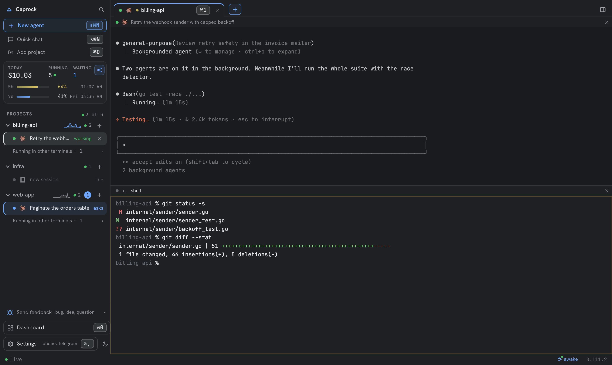
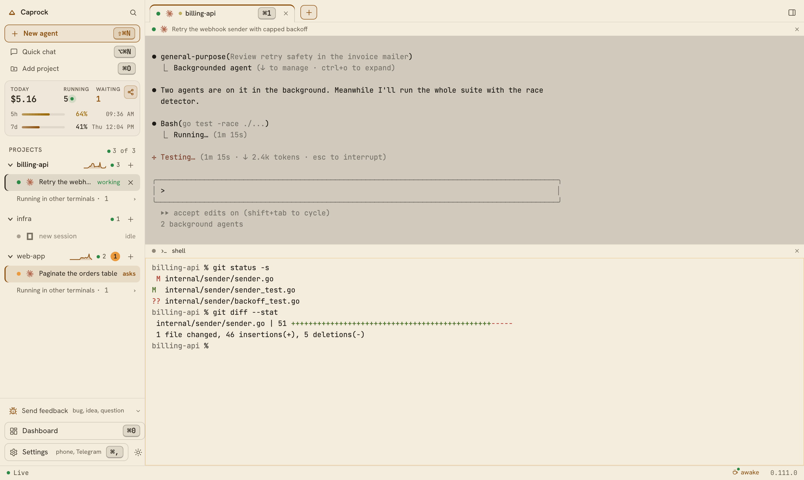

# Using the Caprock desktop app

The app is where you run your coding agents: a terminal for every project,
the sessions that are waiting on you, and the cost and plan limits Caprock
already measures, in one window. It talks to the same local daemon as the
browser dashboard and the phone, so a session started in one is live in the
others. Installing it: [install-app.md](install-app.md).

*Demo projects and sessions, made up for this picture.*

Light theme

## The window

- **Sidebar.** *New agent* (⇧⌘N), the accent-outlined button at the top, starts an
  agent in the project in front; *Quick chat* (⌥⌘N) and *Add project* (⌘O)
  sit under it. Under
  them, *Today*: what every agent has spent today, how many agents are
  running (the dot is green while one is working) and how many wait on
  you, then your Claude plan's 5-hour and weekly windows — the share used
  and when each resets. Click the spend for Cost, a window for the plan
  limits, *Running* for Now, *Waiting* for the session that has waited
  longest. On API billing there are no windows, so there are no bars. Then,
  only while something waits, *Waiting on you*: sessions blocked on a
  permission prompt, then sessions whose turn has ended, oldest first. A
  turn that ended more than 12 hours ago folds under *Older* and is left out
  of the count, the badge and ⌘J; when only such turns are left, the block
  is not shown at all (they stay on the Dashboard). Then the projects, one line each: the
  name, a green dot with how many sessions and shells run in it, and how
  many wait on you. Under each project is every agent session in it —
  working, waiting or idle — one 28-pixel row each, and nothing hides
  behind a *+N more* line. Shells and open files have no rows (they are
  in the tab strip), an ended session drops off, and a row you hide is
  gone until you show it again from *More…*. A row reads the session's
  title (the agent is in its tooltip; a branch shows only when it is not
  the project's own). Click another project to make it
  current: its last tab comes to the front, or its own page when it has
  none. The one highlighted row in the
  sidebar is the tab you are looking at; the current project's name is
  bold, with a faint edge at its left; a session row with a tab shows that
  tab's key (⌘1, ⌘2 …), and a click on a project opens its page. Muted, come the sessions Caprock started
  in the project that still run with no tab; click one to open it as a tab.
  Sessions started in another terminal come last. Each row says its
  state in one word at its right: *working* (green), *waiting* (amber — it
  needs you, and nothing else in the list is amber), *idle* or *done*.
  **Rows keep their places**: in the order the
  sessions started, so picking a row, opening it as a tab, bringing it to
  the front or a change of state never moves it, and
  a new one appears at the end. Drag a row onto another to put it there,
  or focus it and press ⌥⇧↑ / ⌥⇧↓ (Ctrl+Shift off macOS); that order is
  kept, also after a restart. An ended session is
  on the project's page (*Recent*) and in ⌘K. Pinned projects come first,
  then the rest by name, and clicking a project never moves it. Hover a project for *New agent* and *New shell*. Sessions in a
  folder that is not a repository sit under *Outside projects*, and so does a
  quick chat.
- **Projects or Tabs.** A switch beside the sidebar's heading says both
  ways in words. **Projects** lists the sessions under their projects,
  each row with its tab's key (⌘1, ⌘2 …), so the numbers do not run in
  order down the tree. **Tabs** is one list headed *Sessions* of the
  sessions open in tabs, in the tabs' order, each with its tab's key and
  its project's short name in the project's colour; sessions running with
  no tab come after them under a quiet *Running, no tab* line, without a
  key. Dragging a row there (or ⌥⇧↑ ↓
  on it) moves its tab in the strip. The same choice is in Settings →
  Appearance → *Sidebar*; the app remembers it. If you used Caprock before
  and never chose, you keep Projects; a first visit starts on Tabs.
- **Closing things: ×.** Hover a tab under the project — or look at the
  one in front, where it always shows — for its **×**: it closes the tab
  exactly as ⌘W and the tab strip's × do. For an agent Caprock started it
  asks: **Close tab** (in focus, so ⌘W then Enter) leaves the agent running
  — it moves to the muted rows, under *Running, no tab* in the Tabs list —
  and **Close and end the agent** stops it (asking once more if it is still
  answering); its conversation is kept and can be continued. Tick **Don't
  ask again** to keep the answer; Settings → *Closing a tab* changes it
  back. An agent you started in your own terminal is never ended from
  Caprock: its tab just closes. A shell closes for real, as in any
  terminal app: an idle one ends with its tab; one running a program asks
  first — *Shell 1 is running claude. Close and stop it?* — with **Stop and
  close**, **Keep running, close tab** and **Cancel**. A project's **×**
  (*Close project*) closes all its tabs and its shells, tab or no tab — an
  idle shell at once; when any runs a program, one question lists them
  (*alpha: Shell 1 is running claude, Shell 2 is running npm. Stop them and
  close?*) with **Stop and close**, **Keep them running, close tabs** and
  **Cancel** — and hides it (*More…* shows it again). If an agent still runs or
  waits in it, or a shell you kept running, only its tabs close and it
  stays, with its green dot, since hiding it would lose live work. Its
  agents are never stopped. To stop an agent or a shell Caprock started, hover
  its muted row (no tab) for **■**, or right-click its tab for *Stop the
  session…* / *Stop the shell…*; either asks first, as the cockpit does.
  A session started in another terminal has no stop — Caprock never
  signals a process it did not start. Right-click a tab for *Close tab*
  and, when there is one, *Stop…*. Delete and Backspace close nothing.
- **Naming a session.** Double-click an agent's tab in the tab strip, or
  its row in the sidebar, or right-click the row for *Rename…*: the name
  becomes a field. Enter or clicking away saves it, Esc keeps the old one,
  and an emptied field gives the session back the name Caprock made for
  it. The new name shows at once in the tab, the sidebar, ⌘K and Now, in
  this window and every other one, and it stays after a restart; a
  session's own title from the agent never overwrites it. Until you name
  one, a session is called by the agent's own title, or else by a few
  words of your first message — *Fix the login bug* for "can you please
  fix the login bug in auth.go". Shells are numbered, not named.
- **A project's menu.** Click the ⋯ on its row (it shows on hover), right-click the row, or press Shift+F10
  on it: *Hide from the sidebar* (or *Show in the sidebar again*), *Close
  its tabs* — every tab and split of that project; the sessions and shells
  in them keep running — *Open in* each editor found, and *Remove from
  Caprock…*, which asks first and takes the project off the list without
  touching its folder, its files or its sessions; *Add project* lists it
  again. ↑ ↓ move through the menu, Esc closes it.
- **Keeping the list short.** With more than eight projects, the ones with
  nothing running, no tab open and no pin leave the list; with eight or
  fewer, every project shows. A project you close with its × or hide from
  its menu, and a session row you hide, leave it too. One quiet *More…*
  row at the end of the list opens all of them: click another project to
  open it, a hidden project or session to show it again. A project shows
  in the list again while something runs or waits in it, or while it is
  the one in front, hidden or not.
- **Dashboard.** At the bottom of the sidebar, *Dashboard* (⌘0, or ⇧⌘D) opens Now,
  Cost, Lifetime and the other screens in a *Dashboard* tab pinned at the
  left of the tab strip; your terminals stay in the strip beside it, one click
  away, and the tab brings back the screen you left it on until you close it.
  The Dashboard tab is its icon and its key, ⌘0 (⌘, while it shows
  Settings); its × shows while it is in front.
  On the Dashboard's *Today*, each figure has a faint line of your last 14
  days under it and one word: *usual*, *above usual +38%*, *below usual
  −20%*, or *not enough history* in your first days. It compares with your
  own median by the same time of day; hover it for the figures behind it.
  Under *Dashboard*, one row in two halves: the **PRs & CI** mode, named
  *CI Off*, *CI Bar* or *CI Page* (its key, ⇧⌘B, is in its tooltip), and
  the theme, named too. On Windows and Linux each takes a row, and there
  the PRs & CI row shows its key, Ctrl+Alt+Shift+B. The PRs & CI button's
  picture is what is on screen —
  an empty window (Hidden), a band along its bottom (Bar: the session
  deck), a filled window (Full page: the *PRs & CI* tab) — and a click
  moves to the next, Hidden → Bar → Full page → Hidden; ⌘B and ⇧⌘B do
  the same from the keyboard, and the button follows them. Its tooltip
  says the mode and the keys.
  **Mail** sits above *Dashboard*, with its key, ⇧⌘M. It opens Mail in a
  tab of its own beside the Dashboard tab (the envelope and ⇧⌘M); pressed
  again it brings that tab to the front, and its × closes it. With no mail
  account yet it opens straight on a sample inbox — two made-up accounts on a
  server inside Caprock, nothing real read or sent — with a line on top and
  *Add account*: Google, Microsoft, iCloud, Other, or import from Apple Mail
  or Thunderbird. Adding your account leaves the sample; *Exit sample* goes
  to the ways to start.
  The arrow beside *Send feedback* folds that bottom block to one row of
  icons and back; the app remembers which way you left it. Folded, on a
  Mac each icon has its key drawn small above it; on Windows and Linux,
  where the keys are longer, an icon's key shows when you point at it.
  The sliders beside it open Settings (⌘,) in the same tab, where the app puts
  how new agents start, appearance, terminal and editor first. The × beside
  the *Settings* heading, or Esc, closes it as the tab's × does. *Send
  feedback*, the row above *Dashboard*, or ⇧⌘F from anywhere, opens the feedback form: pick Bug, Idea or
  Question — click a card or press 1, 2 or 3, and the title is ready for
  typing — write a title (Enter moves on) and a few words, and paste (⌘V) or choose up to
  four screenshots — drop image files on the window, or on macOS and Windows
  press *Capture window* for a picture of the app itself (not your screen; no
  permission is asked). *Create issue* opens a prefilled GitHub issue in your
  browser, which you read and submit yourself, and puts the first screenshot
  on your clipboard: press ⌘V in the issue, then *Copy next* for the rest.
  Nothing is uploaded by Caprock — GitHub takes what you paste.
- **Dialogs.** Every dialog — Quick chat, New agent, Add project, the
  palette, Share and the rest — closes with the × in its corner, a click
  outside it, or Esc. In the app,
  Now keeps its figures — today, plan limits, the pulse, the repos, all
  time, at a glance, the activity feed — and leaves the session cards and the
  projects panel to the sidebar, which lists the same sessions; the browser
  dashboard shows both. **Repos**, under the pulse, has a row for each
  repository a session runs in: commits a day over two weeks, today's and the
  week's, lines added and removed, files not committed, from the
  repository's own git; with GitHub connected, its open pull requests, red
  runs, median CI time and newest release, as the session deck last read
  them. Fold it and it reads nothing. **CI/CD**, under Repos, needs GitHub
  connected: GitHub's own status (from githubstatus.com), and for each
  repository the Actions minutes GitHub billed this month (with the token's
  Plan (read) permission, or Administration (read) for an organization), the median CI time and its trend, the share of
  red runs, runs stuck far past their usual time or waiting for a runner,
  the newest release, the five pull requests the agents spent most on this
  week with their tokens beside the cost, and who opened them, face and
  name. Costs are at API list price; a session that worked on several pull
  requests is split between them and marked *shared*. Only repositories
  with a session in the last 14 days are read; older ones, and any you hide
  from a block's ⋯ menu, fold into one line (*3 older repositories · 1
  hidden — show*) and are not read from GitHub until you show them. When
  GitHub is slow it says so in one grey line and tries again. Fold it and
  it reads nothing.
- **Live pulse.** One row per running session, led by the session's name,
  with the project, branch and short id under it. Rows keep their places:
  the order sessions started in (tabs follow the tab strip among
  themselves), a new one last; drag a row, or press ⌥⇧↑ ⌥⇧↓ (Ctrl+Shift on
  Windows and Linux) on it, to move it. Two sessions working in the same
  folder of a repository (not separate worktrees) each get a chip naming
  the other; when both edited the same files in the last 30 minutes it
  turns amber, *N files touched by both*, the files on hover. *Move to a
  worktree…* opens New session on a new copy of the folder, named after the
  newer session; the running one keeps going until you stop it. The
  cockpit beside that session shows the same chip. Click a row to open it:
  today's figures for the project with Terminal, Open repo and Open session
  as quiet links at the end of the line, then each live session in it with
  what it is doing on the left and, on the right, what it has cost, its
  last hour, how long it has run, its context, its branch with lines added
  and removed, and its pull request with CI. The legend under the rows
  hides with *Hide*; the **?** in the panel's header brings it back.
- **Quick chat.** Ask something without picking a folder: a session in
  Caprock's data directory opens in a tab, under *Outside projects* in the
  sidebar, and its tab is called *Quick chat* with its model. ⌥⌘N, *Quick
  chat* in the sidebar, the + menu or the palette shows the agents installed
  here, with the agent and model you used last already picked — press Enter
  to start on them, or Esc to cancel. The agents are Claude Code, Codex,
  OpenCode, Gemini CLI, Grok and your custom agents, each with its models:
  click a model to start on it. A line above the chat says how to leave it
  (⌘W closes the tab, /exit ends the chat; × hides the line for good), and
  when the chat ends its tab offers *Close tab* and *Start again*. OpenCode
  lists the models of the providers you connected; with none connected it
  says so, and *Connect a provider* opens a shell tab with `opencode auth
  login` typed for you to run. The agents that are not installed are named
  underneath, each one click from its install command.
- **Agents that are not set up.** In *New agent*, an agent that is not
  installed is listed after the others, marked *not installed*, and never
  picked for you. Choose it and the sheet shows the official install command
  with *Install in a shell tab*: a new shell tab opens with the command typed
  at the prompt, not run — read it and press Enter. Copy and the agent's docs
  are beside it. Grok (xAI's `grok`) is started like the others, but Caprock
  does not read its turns or cost, and says so.
- **Custom agents** (Premium). Settings → *Custom agents* adds any terminal
  coding agent by name, command and arguments, one per line, with `{prompt}`
  where the first message goes and `{model}` where the model goes, plus the
  models to offer. It then appears in New agent and Quick chat and opens in a
  tab. Caprock keeps its sessions in your list but does not read their cost.
  Without a licence key the section is shown with the upgrade button.
- **Claude Code's status line.** Settings → *Status line* picks what
  Caprock's line at the bottom of Claude Code shows. *Full* (the default)
  is everything: model, context, cost, turns, steps and your plan limits.
  *Short* is model, context and plan limits, with the reset time only once
  the 5-hour window reaches 80% — the cockpit already has the rest.
  *Hidden*, the one we recommend, shows no line at all, so Claude Code gets
  its row back, and your plan limits still reach Caprock. *Off* removes
  Caprock's line from Claude Code; Claude's plan limits then stop reaching
  Caprock. A status line you set yourself is never changed.
- **Subscriptions: more than one sign-in.** Settings → *Subscriptions* keeps
  several Claude Code or Codex accounts side by side — a work account and
  your own, say. *Add subscription* makes a folder for it and opens a shell
  tab with the agent's own sign-in typed (`CLAUDE_CONFIG_DIR='…' claude auth
  login`, or `CODEX_HOME='…' codex login`); press Enter there and sign in
  with the account you want. Caprock never sees a password or token. Each
  one is listed with the account it is signed in to, its 5-hour and weekly
  windows and its last seven days. With more than one, *New agent* and
  *Quick chat* show a *Subscription* picker, remembered per project; the
  session runs on it, and its card and inspector say which. When the chosen
  one is at 90% of a window or more, a note says so and names one with room
  — a click picks it for that session only; a running session never moves,
  and Caprock never switches on its own. A new subscription starts with the
  agent's defaults: your settings, plugins and servers are not copied.
  Three per agent are free, your own sign-in included; more come with
  Premium. *Remove* deletes the folder after asking.
- **Claude Code on DeepSeek.** Under Claude Code in Settings →
  *Subscriptions*, paste your DeepSeek API key and *Save key*. *New agent*
  and *Quick chat* then offer **DeepSeek · your API key** in the
  *Subscription* picker; a session started on it is Claude Code in your
  usual setup, talking to DeepSeek's models on your key instead of to
  Anthropic, so your Claude plan and its limits are not used. The note under
  the picker says what it sends to api.deepseek.com; Caprock itself sends
  nothing, and the key reaches only that session. Its card says *DeepSeek*
  and its cost is priced at DeepSeek's list price. Free. *Remove key* turns
  it off.
- **The tab strip.** The tab in front has an amber top edge; the others are
  shaded tabs of their own. A tab reads the session's name, then its
  project's name in the project's colour; when room runs short the
  session's name is shortened first, and a project name that still does
  not fit scrolls into view while you point at the tab. The tooltip has
  both in full. The amber + opens a menu: New agent, Quick
  chat, New shell, Run saved…, Open file, Add project, each with its key.
- **Several attempts at once.** In *New agent*, choose *New copy from a
  branch* and set *Attempts* to 2, 3 or 4, then write the first message. The
  same agent gets the same message in that many separate copies
  (`caprock/<name>-1`, `-2`, …), all from the same commit, each with your
  `.worktreeinclude` files and setup command. They open as tabs named
  *attempt 1/3 · …*, the first in front. *Compare attempts* — in ⌘K, or
  *Compare* in the inspector of any of them — shows them side by side: what
  each is doing, how many files and lines it changed since that commit, what
  it has cost so far (the cheapest is marked) and how long it has run, with
  *Open* and *Review changes* on each. Nothing is merged or removed for you:
  review the one you want, commit it or open a pull request from its
  changes, and remove the other copies when you are done.
- **Saved prompts and commands.** Settings → *Saved prompts and commands*
  keeps what you type over and over, each with a name, for every project or
  for one: a *prompt* such as *Run the tests and fix what fails*, or a
  *command*, one shell line such as `pnpm dev`. ⌘K lists the ones for the
  project in front under *Saved*; + → *Run saved…* lists only them. A prompt
  goes to the agent in the tab in front, typed as if you had typed it, then
  Enter — when Caprock started that agent and it is running; otherwise
  *New agent* opens with the prompt as its first message. A command opens a
  new shell tab in the folder in front (the agent's copy, else the project)
  and runs there. Up to 200, a prompt up to 8 KiB, a command one line.
- **A past session** opens on its chat, with one button: *Resume in a tab*
  (*Branch into a tab* while it still runs elsewhere) and the permission mode
  beside it. Continuing in another agent, opening it in your own terminal and
  copying the resume command are under *More*.
- **The permission mode, while it runs.** A chip beside the agent's name in
  the inspector, and in the session's header, says the mode a Claude Code
  session is in — *asks first*, *accept edits*, *plan mode*, *bypass*. For a
  session Caprock started it is a menu: the modes under *In this session* are
  reached by Shift+Tab, typed in for you and checked on the session's own
  footer; *Restart in …* stops the process and resumes the same conversation
  in a new one, in the same tab, after you confirm, and only when the agent
  is at its prompt. Bypass is in the session once you have accepted Claude
  Code's bypass warning on this computer; before that it is a restart that
  asks for it. A session started in your own terminal shows its mode without
  the menu: change it there with Shift+Tab.
- **Tab names.** A tab is named after its agent, with *+N* for the panes
  split beside it.
- **New project.** ⌘O, *Add project* at the top of the sidebar, or *New
  project…* beside the Project field in New agent opens three big steps.
  Pick the folder: type it, click a place such as `~/dev` and then the
  folder in the list, or press *Choose…* in the desktop app for the
  system's folder picker. Caprock looks inside and says what it found: *One
  repository* (a repository or a monorepo; a folder inside a repository is
  that repository), *3 repositories* as cards, all ticked, to make one
  project of them (or one project each), or *A plain folder*. It also says
  whether the repository already has a `CLAUDE.md` or `AGENTS.md` for its
  agents, with *Show* to read it, and offers a box for instructions every
  agent here should get (optional). Then *Start an agent here*, or *Just
  add*. Enter moves on at every step and Esc closes. Cloning and a new empty
  folder are under *Clone, or start an empty folder…* in its footer.
- **Projects.** Caprock lists the repositories your sessions ran in. The Add
  project sheet adds a folder, makes a new one
  (`git init` optional) or clones a repository with git's progress shown.
  The folder starts at your default folder — your home folder until you set
  one in Settings → Projects (*Where you keep your code*: it limits nothing,
  every folder you run an agent in or add is a project wherever it is) or
  with *Set as default* beside the field — and
  a line under it says what is there as you type: *will be created*, *exists,
  empty — will clone here*, *exists — not empty, clone will fail*, *already in
  Caprock*. Typing a name lists the projects, recent folders and repositories
  under the default folder that match it (↓ and Enter pick one); *no such
  folder* appears only when nothing matches, with the nearest names offered
  (*Did you mean ~/dev/caprock-web?*). *Browse* walks folders (double-click or Enter to go in, *Choose*
  to pick); *Recent* leaves out temp and scratch folders. Paste a repository
  URL and the destination fills in as `git clone` would name it — the
  default folder plus the repository's name; folders that do not exist yet
  are made, and `~` works. Keys: ⌘↩ adds, Esc cancels, ⌘1–3 the modes, ⌘B
  Recent or Browse. A
  *First task* starts an agent on the new project as soon as it is added. Branch, changed files and ahead/behind follow commits
  and checkouts made anywhere, the terminal included. Removing a project from
  the list never touches its files.
- **Project instructions.** Give a project instructions for its agents as you
  add it, or later from the New agent sheet: every Claude Code session
  started in it gets them appended to its system prompt
  (`--append-system-prompt`), and every Codex session as its developer
  instructions (`-c developer_instructions=…`), a resumed one too. OpenCode
  and Gemini do not get them yet. New agent and the project's page show,
  in their own block, whether they are set (*Set · 12 lines* or *None*) and
  whether the repository has its own `CLAUDE.md` or `AGENTS.md` (a
  multi-repo project's members' too); *Show* reads either, *Edit* changes
  Caprock's. Under the Project field, a multi-repo project names its
  repositories (*3 repos: api, web, infra*).
- **New copies are ready to run.** When *New agent* makes a new copy of a
  branch (a git worktree), the ignored files your repository lists in
  `.worktreeinclude` — `.env`, local config — are copied into it from the
  project's folder, the way Claude Code's own `--worktree` does. Under
  *Setup* in the same sheet you can give the project a command such as
  `npm install`: it runs in the agent's terminal before the agent starts, and
  you watch its output there. Ctrl+C skips it; if it fails or runs past ten
  minutes, the agent starts anyway. It never runs in a copy that already
  exists. A paired phone can see the command but not change it.
- **A project with no tab open** shows its recent agent sessions under
  *New agent* and *New shell*: what they cost and when they were last worked
  on. *Continue* carries an ended one on in a new tab, in the permission mode
  it was last running in; *Open* goes to a running one. The sidebar lists only
  what is running, so this is where yesterday's work is.
- **Tabs.** One strip holds every open tab of every project, in the order
  you opened them — an agent session, a shell or a file each — and each tab
  is named by its session, with its project's short name after it in the
  project's colour; hover it for the agent and the branch. A tab has no
  status dot: it is marked only when it needs you — an amber edge along
  its top while the session waits on you, a red one when it failed. The Dashboard tab is its icon
  and ⌘0, and the inspector's button shows ⌘I beside it, as Deck shows ⌘B.
  Picking
  another project never takes a tab out of the strip: the project's own
  tabs are listed under it in the sidebar, under the same names, or its
  page shows when it has none. Picking a tab makes its project current.
  ⌃Tab and dragging run along the whole strip. The strip is in the order
  you opened the tabs: a new tab goes at the end and gets the next number,
  and the numbers change only when you close a tab or drag one; they are
  the same after a restart. ⌘1–⌘9 bring the Nth tab to the front (⌘9 the
  last), and every tab shows its key, the one in front too, as does its
  row in the sidebar. A tab reads its session's name (double-click to
  rename it) and, after it, its project's dot and short name. ⌥⌘↓ / ⌥⌘↑ go to the next / previous session of
  that project and ⌥⌘→ / ⌥⌘← to the next / previous project, both round
  the end. Option+← → stay word jumps in the terminal, and ⌘↑ ↓ stay the
  terminal's. Tabs come back when
  you reopen the app. Closing a tab (⌘W) never stops its agent — a shell's
  tab closes the shell, as above — and the tab beside it comes to the front; *Stop the session…* in the inspector
  stops one, after asking.
- **Split panes.** ⌘E opens a new shell beside the terminal in front, ⇧⌘E
  below it; ⇧Enter on a session in the palette opens it there. Up to four
  panes a tab. Click a pane or press ⌘[ ⌘] to move between them; drag the
  divider, or focus it and use the arrow keys. ⌘W closes the focused pane: an
  agent or a shell in it is treated as its tab would be.
- **Command palette** (⌘K). Sessions waiting on you come first, then actions,
  tabs, sessions and projects, best match first; past sessions are searched
  as you type and listed under *History*. *Keyboard shortcuts* lists every
  key. Type a task that matches
  nothing — "Add rate limiting to the API" — and Enter opens *New agent* with
  it as the first message, in a new worktree named after it.
- **A new copy from a branch.** In the New agent sheet, *Where* offers
  *New copy from a branch*, *This folder* (the project's own checkout, on its
  current branch) and each *Existing copy* by its branch. A new copy is a git
  worktree: a separate folder on a new `caprock/<name>` branch, so the agent
  does not collide with others. *From branch* searches the repository's
  branches, the main ones first (the default branch on top), and *Pull the
  latest … first* (on unless you untick it) fetches it from the remote so the
  copy starts from what the server has now. Caprock remembers that you start
  from a new copy. The branch is named after the first message
  unless you type a name, and `.caprock-worktrees/` is kept out of the main
  checkout's changes.
- **Clean up copies.** A project's ⋯ menu (or ⌘K → *Clean up copies…*)
  lists every git worktree of the project — the main checkout, Caprock's
  copies and any you made yourself — with its branch, when it was last
  committed to, its size on disk and badges: *merged* (every commit is in
  the default branch), *pushed* or *N unpushed*, *N changes* (uncommitted),
  *live* (a session or shell runs in it). Sizes are counted in the
  background; *…* means still counting, and *≥* that a very large copy was
  counted only up to a limit. Tick some — *Select merged and clean* picks
  the ones that lose nothing — and *Remove*. Only copies Caprock made can
  be removed here; the main checkout and your own worktrees never are, and a
  copy with a session or shell running in it says so and stays. When a copy
  has uncommitted changes or commits no remote has, Caprock asks again and
  lists exactly that for each one. Removing deletes the copy's folder,
  ignored files such as `node_modules` included; its branch stays unless you
  tick *Also delete merged branches*, which deletes only a branch whose every
  commit is already in the default branch. *Recently removed* at the bottom
  lists what went, when and how much it freed, with *Restore* for 7 days.
  A copy with no commit for 14 days and no pull request is tagged *stale* —
  a hint, never removed for it.
- **Finished copies clean themselves up.** When a copy Caprock made is
  merged (or its pull request is), pushed, has no uncommitted or untracked
  file and nothing runs in it, the project's page and the deck's Branches
  view say *3 copies done · 2.1 GB · Clean up*. *Clean up* asks once on the
  same line and removes exactly those; *Review* opens the copies list with
  them ticked. Settings → Worktrees chooses *Off*, *Ask* (the default) or
  *Auto*, which removes a finished copy a day after it finished. Afterwards
  the line offers *Undo* for a day, and the branch is kept for 7 days so a
  copy can be restored. The main checkout, worktrees you made yourself and
  unmerged branches are never touched.
- **Terminal.** A real terminal for every session Caprock started and every
  shell, and it keeps running when the app or the daemon restarts. Scrolled
  up, new output never moves what you are reading; a "↓ N new lines" pill
  takes you back down. Drop a file or folder on it from Finder, Explorer or
  your file manager and its path is typed at the prompt, quoted, as in any
  terminal; the agent works on that file, not a copy. Drag a tab along the
  strip to reorder it.
- **Chat.** An agent tab switches between its terminal and its chat with the
  chat button in the tab strip: your prompts, what the agent wrote, and each
  tool call on one line that opens. The field under it types into the
  session. Send while the agent is still working and the message waits as
  a dashed *Queued* bubble; Caprock types it in when the turn ends, one
  message per turn, and never into a permission prompt. **Edit**,
  **Cancel** and **Send now** sit on each bubble, and the phone sees the
  same queue. Type `/` at the start of the field for the agent's commands
  (its own, your project's `.claude/commands` and skills, and yours in
  `~/.claude`), or `@` for a file in the session's folder: ↑ ↓ and Enter
  pick, Esc closes. Picking only fills the field.
- **Agent cockpit** (⌘I). Open beside an agent's terminal unless you close
  it: the agent's portrait with its state and permission mode under it,
  three figures beside it that you pick —
  its burn rate in large type, its tokens and what it has cost on two
  short lines under it, or any of cache hit rate, turns, time working, the
  last call and tool calls (click a figure's ▾), and under the big one how
  it compares with your own last 30 days (*▲ 38%*, *≈ usual*, *▼ 55%*;
  amber only in your top fifth; hover for the whole sentence) — what it
  is doing this second and for how long, right under that how full its
  context is and your plan's 5-hour and weekly windows — one line each,
  *62% · 124.0k / 200.0k* and *5h 41% · 05:40  Week 24% · Mon 13:00*; click
  *Context* or *Plan* for the full meter, what every call now pays to
  re-read the context and each window's bar and forecast, remembered —
  then its spend for the session,
  today, 7 or 30 days as a chart or as three more figures you choose
  (*Chart | Numbers*; the chart's ▾ switches its bars between cost, burn
  rate — dollars per hour you actually worked in each stretch — tokens and
  turns, and a faint dashed line marks your pace: your usual burn rate, or
  the period's average stretch, so hovering a bar says *38% above your
  usual*; fold it to a strip of the same bars and three figures if you
  like), the task list the agent keeps for itself (each task with a spinner, a
  check or an empty circle, and *3 of 7 done* above them; not there when
  the agent kept none), its subagents (a chip per subagent under the
  agent, in groups of five so you can count them at a glance, on up to
  two lines and smaller squares when there are many, and a row each below
  that leads with its type's letter and what
  it is doing now in words, up to two lines, from the description Claude
  gave its latest command, else its tool and file, else its task; the rows
  keep the order the subagents started in, a finished one dimmed with a ✓
  where it stood, and *Show* above them picks which of calls, cost, model
  and time each row carries, cost and time until you choose: click one to open it in place and read the
  task it was given, every call it makes as it makes them, what it
  answered and what it cost), its last tool calls — each with the file it
  touched (relative to the project) or the program a command ran, how it
  ended (a quiet ✓, *exit 1* or *error* in red, the time it took when it
  was slow, the clock running for the one running now) and how long ago,
  the same call repeated in a row shown once with *×3* — the uncommitted
  changes in its checkout, and a warning when
  it is repeating the same call. Every section — Now, Subagents, Tasks,
  Recent tools, Changes, CI, Processes — folds to one line on its label,
  like Context and Plan, and stays as you left it. In CI, hover a pull
  request's checks for a moment to list them all beside the panel;
  *PRs*, *Ring* and *By OS* switch what it shows (*By OS*: the newest pull
  request's checks on Linux, macOS and Windows, each with its state and
  time).
  To put the sections in another order, click *Arrange sections* under
  the last one: each section gets ↑ and ↓, *Reset to default order* puts
  them back, and *Done* (or Esc) returns. Nothing moves by dragging a
  heading, so it never happens by accident, and the order is kept for
  you on this computer. The permission prompt and its buttons sit
  at the top while one waits. Click a changed file to read it in a tab
  (in a folder that is not a git repository, it opens in your editor at
  its first change). Beside a shell tab it shows the folder and its
  changes.
- **Claude's faces.** Claude's little character comes in eight looks — the
  hard hat, a beanie, headphones, a crown, a wizard's hat, a tuft of hair,
  a bandana and a propeller cap. Each session gets one at random and keeps
  it everywhere it shows, on your phone too; click the portrait in the
  cockpit to give a session another. Settings → Appearance → *Claude's
  face* picks the default: a face per session, or the same one for all.
  There are rubber ducks too, for rubber-duck debugging: eight of them —
  classic, debugger, on call, party, pirate, hacker, sleepy and rainbow —
  on the *Ducks* tab of the same menu. Sessions only get a random duck if
  you ask for it in Settings (*A duck per session*, or *Faces and ducks*);
  now and then an idle Claude asks "try a duck?" beside its portrait —
  click it to see them, or × it, and after two ×s it stops asking.
  Remembered in this browser only. Other agents keep their own marks.
- **Session deck** (⌘B). A band under the terminal of the agent in front,
  so the prompt sits above the window's edge, nearer the middle of the
  screen, with what is useful while you work in the room it makes: the CI
  of the session's pull request, its branch with what is not committed or
  pushed, and its latest pull requests. *CI* lists every GitHub Actions job
  of the PR's latest commit with its state, OS and time (ticking while it
  runs), in as many columns as the deck is wide, and the runner time so far, measured from GitHub's job times and
  split per OS — never turned into money. Click a job for its steps and
  their times; click a failed step for the lines around the error in its
  log, with a link to the job on GitHub. CI needs GitHub connected (one
  click, through `gh`). Drag its top edge to resize it (up to 60% of the pane), or
  focus the edge and use ↑ ↓; double-click it for the default height. The
  PRs & CI button at the foot of the sidebar, the deck button beside the
  inspector's, ⌘B and the palette open and close it;
  the app remembers its height and whether it was open. A shell tab has no
  deck. It opens on all of the session's pull requests, each title as long
  as the row allows, with its checks as a circle per check (coloured by
  state, the running ones pulsing) or, switched in the header (*Checks:
  circles | summary*), summed up in a few words — *✗ 1 failed ● 1 running ✓
  10*, or just *✓ all 12 · 6m* once everything passed — and opens one only
  when you click it; the next time it opens on that one. Hover the checks for
  every one: its name, OS, state, time and the step a failed one stopped
  at. The cockpit on the right has a **CI**
  block with the same summary, or one ring with *10/11 · 5m*, or the jobs by OS, switched in its
  label; it shows what the deck last read and a click opens *PRs & CI*.
  ⇧⌘B, or the sidebar's PRs & CI button from *Bar*, opens it large in a tab of its own,
  *PRs & CI*. It opens on the **Board**: the repository's pull requests as
  cards in six columns — Draft, CI running, Needs a fix, Ready, Merged,
  Released — each card with its title, the author's face and name, how long
  it has been in that column, its CI, the agents working on it now and its
  *agent cost* (what Caprock recorded agents spending on it, at API list
  price — not a bill); above, how fast work flows (merges a day, opened →
  merged, merged → released as an estimate, the CI median); below, each
  recent release with the pull requests it shipped and what the agents spent
  on them. Click a card to open it in the **List**:
  the repository's last two weeks on top (pull requests merged
  per day, the median time to merge, the median CI run, the share of red
  runs, the Actions minutes GitHub billed this month), its pull requests on
  the left (this session's, the repository's or the open ones), and the one
  you pick on the right with its state, review, merge state and diff size,
  the deck's actions, its jobs by runner OS against each one's usual time,
  the jobs on a timeline, and a failed job's steps and log with
  *Investigate*. **Collapse** in its top-right corner, and ⇧⌘B
  again, close the tab and show the agent with its deck; the sidebar's
  button closes it and hides the deck too. It reads GitHub
  only while it is in front.
- **Changes.** Click a worktree's ±N in the sidebar (hover the row for the
  same button), *Review and commit* in the inspector, or "Review changes" in
  the palette. The files are listed as *Staged*, *Changes* and *Conflicts*;
  the one selected shows its diff, unified or side by side (**v**). Hover a
  file to stage, unstage or discard it, or press **s**, **u**, **d**;
  **j**/**k** move between files. A diff's *Stage hunk* takes one hunk.
  Discarding throws away a file's unstaged edits, or deletes a new file,
  and asks first; staged work is kept. Write a message (*Use the agent's
  summary* starts one from what the agent said last), then *Commit* (⌘↵) —
  the staged files, or every change when nothing is staged — or *Commit &
  Push* (⇧⌘↵). *Push* publishes a new branch and tracks it, and never
  forces; *Pull* only fast-forwards; *Fetch* refreshes ahead and behind.
  Your git hooks run, and when one refuses, what it printed is shown. The
  commit is made as the author your git config names. **o**, the ↗ on a
  file's row or its name above the diff opens the file itself in a tab.
- **Review notes for the agent.** In the Changes view, click a line number
  of the diff to write a note on that line; ⇧-click another line number to
  stretch it over a range. Enter keeps the note under its line (⇧Enter for
  a new line, Esc cancels); *Edit* and *Delete* sit on each note. Notes
  stay with the worktree until you send them, through tab switches and
  restarts. The bar under the diff counts them (*Show* lists them; click
  one to go to it) and **Send to agent** (⇧⌘↵) types them all into the
  agent working in that worktree as one message: each note with its file
  and lines, and the code it is on. Caprock types only into a session it
  started that is still running, and not while that session waits on a
  permission prompt — answer it first. With no such session the button
  reads **New agent with the notes…** and opens New agent in that worktree
  with the notes as the first message. The notes are cleared once they
  are sent or the new agent starts.
- **Fix with agent.** Where the Changes view shows something that failed,
  **Fix with agent** hands it to the agent working in that worktree, with
  a short instruction to find the cause and fix it: a commit or push your
  git hook refused (with the end of what the hook printed), files left in
  conflict by a merge, rebase or stash (the list of them), and the pull
  request's failing checks (by name and link) or its conflicts with the
  base branch. It goes where review notes go — typed into the session
  Caprock started there, or, with none running, **Fix with a new agent…**
  opens New agent in that worktree with it as the first message. The agent
  is asked to leave committing, pushing and finishing a merge to you.
- **Files.** Read any file of a project without leaving the app, in a tab
  named after it (hover for its path). ⌘K → *Open file…* lists the files of
  the worktree you are in — what git tracks and new files it does not
  ignore — and narrows them as you type. Markdown is shown formatted, with
  a *Source* switch; a link to another file in the project opens it in a
  tab, a web link opens in your browser, and an image shows as its
  description. Any other text is shown with line numbers, wrapped unless
  you switch *Wrap* off; ⌘F finds in it. The tab is read-only and reads
  the file again when you come back to it or an agent changes it. A binary
  file, or the part of a file past its first megabyte, is left to your
  editor (*Open in …*).
- **Find** (⌘F). A find bar over the terminal you are in: matches light up
  as you type, Enter and ⇧Enter step through them, **Aa** matches case and
  **.\*** takes a regular expression. Esc closes it and you are back in the
  terminal.
- **Open in your editor.** A project's menu (its ⋯, or a right-click) and a
  right-click on a worktree in the sidebar open it in VS Code, Cursor, Zed or a JetBrains IDE — whichever
  are installed; the palette and the inspector have *Open in …* too.
  Settings → *Editor* picks the default. Only this computer can do this; a
  paired phone cannot open an editor here.
- **Themes.** Eight, picked from the sun/moon button under *Dashboard* at
  the foot of the sidebar or Settings → *Appearance*: Dark Pastel (a neutral graphite with
  soft, muted colours, the default dark one), Dark Warm, Dark Cold and Dark
  Side; Light, Light Cold, Book (the default light one) and Light Side. Until
  you pick one, the app follows your system's light or dark setting. Point at one to try it on the
  whole window, click to keep it. Dark Side and Light Side add a soft glow to
  the focused field, the primary button and the tab in front.
- **Terminal look.** Settings → *Terminal*: the colours (*Match app*,
  Dark Warm, Dark Cold, Dark Pastel, Book, Light Cold, Light Side, Dark Side, Catppuccin
  Mocha, Tokyo Night, Solarized Dark), the font (JetBrains Mono,
  or SF Mono, Menlo, Fira Code and other monospace fonts you have), size,
  line height and cursor, with a preview. Every open terminal changes as you
  choose. *Match app*, the default, follows the app's theme: each theme's
  own terminal colours on the window's own colour, so the terminal reads as
  part of the window; a palette you pick stays whatever the app shows. The font defaults match the JetBrains IDE terminal: JetBrains
  Mono, 13 px, line height 1.2, no ligatures.
- **Permission mode.** A new install starts sessions in *Accept edits · asks
  first*: the agent edits files on its own and asks before running a command.
  *Bypass · never asks* is one pick away in the New agent sheet, and the mode
  you pick there is kept for the next agent. The first time bypass is picked
  on a computer, the New agent sheet shows what bypass means and its
  button reads *Accept and start*; that answers Claude Code's own one-time
  warning for good. A paired phone cannot give that consent — accept it once
  at the computer. Settings → *New sessions* → *Start in* picks the mode
  a new session starts in. Continuing a session keeps the mode it was last
  running in — a session you ran with permissions skipped carries on that
  way. The mode shows next to the continue button, where you can change it.
- **Status strip.** Whether the daemon is live, the front terminal's size,
  and a newer Caprock when one is out ([Updates](#updates)). With the
  sidebar hidden (`⌘\`) it also shows the 5-hour and 7-day plan windows and
  today's spend, which the sidebar's *Today* carries while it is open.

### Keyboard

On macOS:

| Keys        | Does                                                                     |
| ----------- | ------------------------------------------------------------------------ |
| ⌘T          | New shell in the folder of the tab                                       |
| ⇧⌘N         | New agent session                                                        |
| ⌥⌘N         | Quick chat: pick, or Enter for the last                                  |
| ⌘O          | Add a project: one repository or several (clone, new: in its footer)     |
| ⌘1–8, ⌘9    | The Nth tab, in the order opened; the last                               |
| ⌥⌘↓, ⌥⌘↑    | Next and previous session of the project in front                        |
| ⌥⌘→, ⌥⌘←    | Next and previous project                                                |
| ⌥⇧↑, ⌥⇧↓    | Move the focused session row up or down in the sidebar or the Live pulse |
| ⌃Tab, ⇧⌘[ ] | Next and previous tab                                                    |
| ⌘W          | Close the tab (the session keeps going)                                  |
| ⌘E, ⇧⌘E     | Split: a new shell beside, below                                         |
| ⌘[ ]        | Previous and next pane                                                   |
| ⌘J          | Next session waiting on you                                              |
| ⇧⌘H         | Add to brain: keep a line in Second Brain                                |
| ⌘F          | Find in the terminal or the file                                         |
| ⌘K          | Command palette                                                          |
| ⌘,          | Settings                                                                 |
| ⇧⌘F         | Send feedback                                                            |
| ⇧⌘M         | Mail, in a tab of its own                                                |
| ⌘+ ⌘− ⇧⌘0   | Interface size: bigger, smaller, default                                 |
| ⌘I          | Agent cockpit (the inspector)                                            |
| ⌘B          | Session deck (the PRs & CI bar) under the agent's terminal               |
| ⇧⌘B         | PRs & CI as a full page in a tab; back to the bar                        |
| ⌘\          | Hide or show the sidebar                                                 |
| ⌘0, ⇧⌘D     | Dashboard tab, and back                                                  |
| ⌘R          | Reload the window (View → Reload)                                        |

On Windows and Linux each is Ctrl+Shift with the same letter or arrow
(Quick chat is Ctrl+Alt+Shift+N, the PRs & CI full page Ctrl+Alt+Shift+B,
Send feedback Ctrl+Alt+Shift+F, since Ctrl+Shift+F is Find; tabs are
Ctrl+Shift+1–9; Add to brain is Ctrl+Shift+H). The arrow
chords are Alt+Shift there (Alt+Shift+↓ ↑ sessions, Alt+Shift+→ ←
projects), since Ctrl+Shift+← → are
PowerShell's select-by-word, and moving a sidebar row is Ctrl+Shift+↑ ↓;
in a text field the arrow chords stay the field's. Ctrl+Shift+C
and Ctrl+Shift+V stay the terminal's copy and paste. Reload is F5 there:
Ctrl+R stays the shell's history search, and F5 in a focused terminal goes
to the program running in it. The terminal's own keys (Ctrl+C, Ctrl+W,
Option as Meta) always reach the terminal.

**Composer (optional).** Settings → Terminal → *Composer: type in a box
under the agent* puts a message box under the terminal of every agent
Caprock started. Enter sends the message (several lines arrive as one),
Shift+Enter starts a new line, Esc goes back to the terminal, and ↑ ↓ on an
empty box bring back what you sent before. `/` and `@` open the command and
file pickers, *Saved* puts a saved prompt in the box, and a pasted image goes
into the agent's prompt as in the terminal. While the agent works, a message
waits in the queue and the box says so; when the agent asks for permission,
the box tells you to answer in the terminal. It is off by default, and with
it off nothing about the terminal changes; the box's ⋯ menu turns it off
again. Sessions started in another terminal never get one.

The interface size lives in Settings → Appearance (100, 110, 125 or 140%),
and the app opens at 110%. It zooms the whole window natively, terminal
included, so text stays sharp and clicks land where they should. In a
browser the browser's own zoom does the same job, so the setting is the
app's alone.

### After an update

When the daemon is updated while a window is open — the app replaces its
daemon after an upgrade, or `brew upgrade` restarts it under a browser tab —
the page reloads itself onto the new version as soon as it reconnects, on
the screen it was showing. What you typed in a terminal is kept: it lives in
the session, not in the page. If a sheet is open with text in it, the page
does not reload under you; *Reload — Caprock was updated* appears in the
status strip (in a browser, in the header) instead, for when you are done.

The *New agent* sheet needs no mouse. It opens on the Project search, with
the current project first: Enter keeps it and a second Enter starts. Type any
part of a name and the list narrows to your projects, the folders you worked
in recently and the repositories under your default folder, two levels deep;
↑ ↓ and Enter pick, Esc closes the list (a second Esc the sheet). A folder or
repository that is not a project yet is added when you pick it. Tab and
⇧Tab walk Project, Where, Agent, Model, Permissions, First message, Cancel
and Start; ↑ and ↓ change a choice in place (Space still opens the list);
⌘↩ (Ctrl+Enter off macOS) starts from anywhere in the sheet, the selects
and the first message included, and Esc cancels. The footer names these
keys, and the Start button carries its own. Focus moves only when you move
it: nothing that updates behind the sheet takes it from the field you are in.

## Outside the window

- **Menu bar** (a tray icon on Windows and Linux). On macOS a click on the
  icon opens a small panel under it without leaving the app you are in: what
  needs you first (a permission prompt with **Approve** when the whole
  request fits on the panel, else **Deny** and *Review in Caprock*; then
  sessions whose turn ended), then what is running with its cost, today's
  spend, and the Claude and Codex 5-hour and 7-day windows with when they
  reset. Click a session to open it in the window; Escape or a click
  elsewhere closes the panel. A right click shows the menu: the same figures,
  the sessions waiting on you, *Show Caprock* and *Quit*. On Windows and
  Linux the menu is the whole tray. On macOS the sessions waiting on you
  are named beside the icon (*2 waiting*), and a plan window joins them,
  named, once it is 80% full (*2 waiting · 5h 86%*).
- **Badge.** The Dock icon (a dot on the Windows taskbar) counts the sessions
  waiting on you — a permission prompt, or an agent that finished and waits
  for your answer: the popover's *Needs you* — and clears when none do.
- **Global shortcut.** ⌃⌥⌘C on macOS, Win+Alt+C on Windows and Linux, brings
  the window up from any app, and hides it when it is already in front.
  Change it or turn it off in Settings → *Global shortcut*. Wayland does not
  give apps global shortcuts; the tray's *Show Caprock* still works there.
- **Folding dashboard panels.** Click a panel's title (the arrow beside it)
  to fold it down to the title, and again to bring it back; Caprock remembers
  each one. On Now, *fold to icons* turns the agents' cards into one line of
  characters with their shares.
- **The version in the status bar.** Click it to see whether an update is
  out and when Caprock last checked, update in one click (sessions keep
  running) or copy the command, read the first lines of what changed, or
  check now. An accent dot beside the version means an update is out.
- **Keeping the computer awake.** While an agent is working or waiting for
  your approval, Caprock stops the computer from falling asleep for
  inactivity, and lets it sleep again once nothing works (or after half an
  hour without a word from a session). The screen can still turn off, and
  closing a laptop's lid still sleeps it. In the status
  bar *awake* with a cup, in colour, says it is happening, and *may sleep*,
  faint, that it is not; click it to see why and to switch the mode. Settings → *Keep awake* turns it off or keeps the
  computer awake for as long as Caprock runs. On Linux it needs
  `systemd-inhibit`.
- **Closing the window.** On macOS Caprock stays in the menu bar; ⌘Q quits.
  On Windows and Linux closing quits. Quitting never stops the daemon or a
  session.

## Second Brain

The few answers worth keeping, kept as a graph: ideas, decisions, findings
and open questions, each linked to its project and topics and to the moment
in the session it came from. Open it from *Brain* in the dashboard's screen
row.

- **Drop an answer in.** Under any answer on the Memory screen, in a
  session's Answers tab, or under a reply in the chat view, press **Drop into
  brain**. Caprock reads the answer from its own record, so the memory knows
  its session, project and time; its first line becomes the title.
- **Add a line of your own.** ⇧⌘H (Ctrl+Shift+H on Windows and Linux), or ⌘K
  → *Add to brain…*: type it, pick Idea, Decision, Finding or Question, name
  topics if you like, and ⌘↩.
- **See it as a graph.** The Brain screen opens on the graph: your memories
  and the topics and projects they hang off. Drag to move, scroll to zoom,
  double-click to fit, click a dot to open it; *List* shows the same as
  rows. In the app's sidebar, the Brain block below your projects shows the
  newest thirty as a small graph — a new memory drops in as it is kept —
  and the three newest titles.
- **Find and tidy.** Search, pick a project or a span; open a memory to edit
  its title and summary, pin it, link it to a topic, jump to the session it
  came from, or delete it.
- **Let it build itself (Premium).** With a licence, the Brain screen asks
  once whether to build it automatically; Settings → Second Brain switches it
  later. When a session has been quiet for ten minutes, Caprock asks your own
  `claude` (a small model, Haiku) to pick out what it decided and found, and
  keeps those as memories linked back to the moment they were said. Short
  sessions are skipped, reads stop at a daily token limit you choose (100k,
  300k or 1M), and *Build from my last 30 days* shows an estimate of how many
  sessions and tokens that is before it starts. These reads use your Claude
  plan like any other `claude -p` call; they do not show up as sessions and
  do not run your hooks.
- **New sessions draw on it.** When Claude starts in a folder and is handed
  where the last session left off, it also gets up to five of that
  repository's memories, pinned ones first.
- **Free and Premium.** Twenty memories dropped in by hand are free; Premium
  keeps every one and builds the rest for you. Whatever you kept stays
  readable and editable if a licence lapses.

**Privacy.** Second Brain lives in Caprock's database on this computer, and
nothing in it is sent to Caprock. Dropping memories in by hand sends nothing
anywhere. Building it automatically is off until you say yes: then a finished
session's prompts and answers go to your own `claude`, which sends them to
Anthropic under your login, the place the session itself already went.

## Notifications

When an agent stops on a permission prompt, the app shows a notification
naming the project, the session and what it wants to do: `Bash: go test
./...`, the file an edit would change, or the question it asked. Nothing is
shown for the session you are already looking at.

On macOS the notification carries buttons:

- **Approve** answers *yes* to that prompt, without bringing Caprock forward.
  It is offered only when the notification shows the whole request, on one
  line and uncut. A longer command offers **Open in Caprock** instead, so you
  read it in the session's terminal before answering.
- **Deny** answers *no*.
- A click on the notification opens the session. Its terminal shows Claude
  Code's own prompt, and Caprock's approval card sits under it, naming the
  tool and the full command.

The card answers from the keyboard, with focus in that session's terminal
too: **Y** for *yes*, **A** for the "don't ask again" option when the prompt
has one, **N** for *no*. In the terminal, Enter and Esc answer Claude Code's
own menu, which means the same *yes* and *no*; with focus off the terminal
they press the card's buttons. Before pressing anything, Caprock reads the menu on the
session's screen and picks that option's own number. If the option is not on
the prompt, it types nothing and asks you to answer in the terminal. When
several prompts wait — a subagent's among them — the card shows the one on
screen and how many more are waiting.

A notification never offers "always allow", because that would write a rule
to your settings. If the prompt was answered in the meantime — in the
terminal, on the card, from the phone — the button does nothing and says
*Already answered*, and the notification is taken away when the prompt goes.
macOS asks once whether Caprock may send notifications.

On Linux the notification has Approve and Deny too where the desktop's
notification server draws actions, and a click opens the
session. On Windows a notification has no buttons; a click opens the session
with its Yes and No buttons.

Settings → *Desktop notifications* has two switches: *waiting for approval*
(on) and *has finished* (off). They are separate from the Telegram alerts in
[Phone alerts](../README.md#hear-about-it-on-your-phone--and-answer-from-telegram), which stay off until
you turn them on.

With Premium's plan-window stop on (Settings → *Pause at the plan limit*), a
notification names the sessions it paused and the time they resume, and a
second one says when they have. These come whenever the stop acts; there is
no switch for them. See [Premium](../README.md#premium).

## GitHub

Settings → **GitHub** connects your account. Caprock then talks to
`api.github.com` from the daemon; the token never reaches the page or your
phone. Nothing is sent to GitHub until you connect. Besides
`api.github.com`, and never with your token: when you click a failed CI step
in the session deck, the job's log is downloaded from the signed address
GitHub points to on its log storage; while Now's CI/CD section is open, the
daemon reads `www.githubstatus.com`'s public status at most every five
minutes; and the PRs & CI Board and the CI/CD section show pull request
authors' pictures from `avatars.githubusercontent.com`, loaded by the page
with no referrer.

**Connecting**, easiest first:

- **Use my GitHub CLI login.** If `gh` is installed and logged in, Caprock
  asks `gh auth token` whenever it needs the token and never writes it down.
  Disconnecting leaves your `gh` login alone. Missing a scope? Run
  `gh auth refresh -s repo,read:org`.
- **Paste a token.** A fine-grained token with *Contents* and *Pull
  requests* read and write, and *Commit statuses*, *Checks* and *Metadata*
  read, on the repositories you want; or a classic token with `repo` and
  `read:org`. Caprock checks it with GitHub before keeping it — in your
  macOS login keychain, or a file in the data directory only you can read
  (on Windows and Linux, or when the keychain is unavailable; Settings says
  so).
- **Sign in with GitHub**, once a Caprock OAuth app is configured (below):
  Caprock shows a code, you enter it on github.com and approve.

Connected, the section shows the account, the scopes, a health line (when
GitHub last answered, requests left this hour, a rate-limit pause, the last
error word for word), *Tell me when CI fails or a review arrives*, and
**Disconnect**, which removes only the token Caprock kept.

**What it does:**

- **Clone from your repositories.** ⌘O → *Clone*, and *Start work → Clone*
  on the phone, list your repositories and your organizations'; search by
  name, pick an owner, *More…* for the next page. Picking one fills the
  address; you can still paste any other.
- **Put a project on GitHub.** In a project with no remote, the Changes view
  offers **Create a GitHub repository…**: private unless you untick it,
  under you or an organization, set as `origin`, and pushed.
- **Open a pull request.** In a worktree's Changes view, **New pull
  request…** fills the title and description from the branch and its
  commits (or the agent's summary), against the default branch, with a
  *Draft* switch. A branch not on GitHub yet is pushed first, with your own
  git credentials. Then the link.
- **Follow it.** The Changes view shows the pull request's checks (the
  failing ones by name), reviews and whether it can be merged; the sidebar
  shows a pull-request icon on the worktree, green, amber or red. Caprock
  reads each repository at most once a minute, less often while nothing
  changes, and right after you push. With the switch on, the app notifies
  you when a check fails or a review arrives. Failing checks and a pull
  request that conflicts with its base have **Fix with agent** (see
  [Fix with agent](#the-window) above).
- **Start an agent from an issue or a pull request.** In *New agent*, for a
  project on GitHub, click *From a GitHub issue or pull request…* (or ⌘K →
  *New agent from issue…*) and pick one of the open ones; type to search by
  number, words, author or label. An issue fills in a new copy named after
  it (`issue-123-short-slug`) and a first message with its title, link and
  text. A pull request does the same and starts the copy at the pull
  request's latest commit, fetched with your own git credentials — from a
  fork too — so the agent can review it or carry on. Change anything before
  *Start*; attempts, `.worktreeinclude` and the setup command work as
  usual. The copy is on a branch of its own (`caprock/pr-13-…`): pushing it
  opens a new branch on GitHub, not the pull request's, so to add to that
  pull request push to its branch yourself.
- **From the phone** you can read all of it; a phone you let control
  sessions can also open a pull request. Connecting, disconnecting and
  creating repositories happen on the computer.

### Turning on "Sign in with GitHub" (for the maintainer, about 5 minutes)

The device flow needs an OAuth app registered once; its client id is public
and there is no secret on anyone's machine.

1. On github.com: **Settings → Developer settings → OAuth Apps → New OAuth
   App** (or the organization's *Developer settings*, to own it there).
2. *Application name* `Caprock`, *Homepage URL* `https://caprock.dev`,
   *Authorization callback URL* `https://caprock.dev` (the device flow does
   not use it, but the form requires one). **Register application**.
3. On the app's page tick **Enable Device Flow** and **Update application**.
   Do not generate a client secret; Caprock does not use one.
4. Copy the **Client ID** (`Ov23…` or `Iv1.…`).
5. Put it in the data directory's `config.json` (`~/Library/Application
   Support/caprock` on macOS unless you moved it) as
   `"github_client_id": "<client id>"`, then restart the daemon
   (`caprock down && caprock up`, or quit and reopen the app). To ship it to
   everyone, make it the default in `internal/config` instead.

Settings → GitHub then shows **Sign in with GitHub**. The app asks for
`repo` and `read:org`. An organization with OAuth app restrictions must
approve the app before its private repositories show up.

## Where your keys are kept

Caprock keeps four kinds of credential, and none of them is in
`config.json`, its database or a log. Settings shows only a hint (`sk-…1a2b`)
and says under each field where it is; the (i) beside it explains the rest.

- **DeepSeek API key, Telegram bot token, a pasted GitHub token.** On macOS,
  your login keychain (items `dev.caprock.deepseek`, `dev.caprock.telegram`,
  `dev.caprock.github`; you can see them in Keychain Access). On Windows and
  Linux, or if the keychain refuses, a file only your user can read in the
  data directory: `deepseek-api-key`, `telegram-bot-token`, `github-token`.
  The data directory is `~/Library/Application Support/caprock` on macOS,
  `%AppData%\caprock` on Windows and `~/.config/caprock` on Linux.
- **Mail passwords.** Your system keychain: the macOS login keychain, Windows
  Credential Manager, or the Secret Service on Linux; without one,
  `mail-secrets.json` in the data directory, readable by you only.
- **What each is sent to.** The DeepSeek key goes only to `api.deepseek.com`,
  from the environment of a session you start on DeepSeek. The bot token goes
  only to `api.telegram.org`. The GitHub token goes only to `api.github.com`.
  A mail password goes only to the mail servers you entered. Nothing goes to
  Caprock.
- **Backups.** Time Machine backs up the login keychain encrypted; it reaches
  iCloud Keychain only if you move an item there yourself. A key in a file is
  backed up like any other file in your home folder.
- **Removing one.** Remove (Disconnect for Telegram and GitHub, Remove
  account for Mail) deletes it from the keychain or the file. To make a key
  useless everywhere, revoke it where it was made: DeepSeek's API keys page,
  `/revoke` to @BotFather, GitHub's token settings, your mail provider's app
  passwords.

A key that an older Caprock wrote to `config.json` is moved to the keychain
or the file the next time the daemon starts, and removed from `config.json`.

## Updates

When a newer Caprock is out, a card in the bottom-right corner says so,
once per version: **Update and restart**, *What's new*, or **Later**. The
status strip keeps **Update to vX.Y.Z — Restart** for when you are ready. One click downloads it (with progress, while you keep working),
checks its signature, installs it and restarts the app. Everything comes
back as it was: every session keeps running (their terminals live outside
the app, and the app moves its daemon onto the new version without ending
them), the same tabs in the same order with the same one in front, splits
and their sizes, the sidebar, the window's size and place, each terminal
scrolled where you left it, and anything you had half typed into an agent. The ▾ beside it
shows what is new, or **Not now** to hide that version.

- **Checking.** On its first launch the app asks once: *Check for updates
  automatically?* With **Yes**, Caprock asks GitHub for the newest version
  number at most every 6 hours; Settings → *Privacy* turns it off again.
  With **No**, nothing is checked until you ask: **Caprock → Check for
  Updates…** on macOS, **Check for Updates…** in the tray menu, or *Check for
  updates* in the command palette (⌘K).
- **What is sent.** The automatic check asks GitHub which release is the
  latest. *Update* and *Check for Updates…* also fetch the release's
  `latest.json` and, when you update, the new app from GitHub's release
  downloads. None of these carries anything about you or your work: no
  account, no identifier, not even your version.
- **What is checked.** Every update is signed with Caprock's release key,
  and the app installs nothing whose signature or version does not match.
  If something fails, the strip says *Update failed* and why, with **Try
  again** and the release page; the running version is left as it was.
- **Where the app updates itself.** The macOS app (from the `.dmg` or
  Homebrew), the Windows installer and the Linux AppImage. On macOS, move
  Caprock to Applications first: run from the disk image it cannot replace
  itself and says so. A Homebrew cask install updates itself too, and `brew
  upgrade` leaves it alone.
- **Where it does not.** The `.deb` and `.rpm` packages belong to your
  package manager: download the new `Caprock-Linux.deb` or
  `Caprock-Linux.rpm` from the
  [release page](https://github.com/dspv/caprock/releases/latest) and
  install it the way you installed the first. The app tells you which.
- **The daemon from Homebrew or Scoop** keeps its own upgrade command
  (`brew upgrade caprock`, `scoop update caprock`); the app never replaces a
  daemon it did not install.

## A question from Caprock

Caprock cannot see who uses it, so after you have used it on two different
days it may show one short strip at the bottom of the window: a question
about a feature it is considering (running Hugging Face models on your
computer, or one other). At most one a
day; it waits until you stop typing, never appears while a session is
waiting for a permission answer, and never covers a terminal.

- **Second Brain.** The strip used to offer it ahead of its arrival; it
  has arrived (see [Second Brain](#second-brain)), so the strip no longer
  shows it.
- **Answering a question.** Two one-click questions and an optional email,
  if you want to hear when it is ready.
- **What is sent, and when.** Nothing, until you press **Send**. Then
  Caprock sends your two answers, which question they answer, and your email
  if you added one, to caprock.dev. Nothing else: no identifier, nothing
  about your sessions, projects or usage, not even Caprock's version.
- **Saying no.** *Not interested* or × sends nothing.
- **How often.** An answered strip never comes back. Second Brain and the
  Hugging Face question are shown at most twice each, the others once.

## macOS privacy prompts

macOS asks before a program reads your Desktop, Documents or Downloads
folder, your Music or Photos library, or a network or removable volume
(System Settings → Privacy & Security). A session Caprock runs — Claude
Code, Codex, a shell — asks in its own name: Caprock starts each one
responsible for itself, the way iTerm2 does, so the prompt says "claude" or
"codex", not "caprock", and Claude Code keeps your answer across its
updates. Caprock itself asks only for a folder you open in it, and for
Desktop, Documents or Downloads when a session runs there (it reads up that
folder to group the session under its repository). It never reads your Music
or Photos library, cloud storage or a volume in the background.

- **What to allow.** Allow the folders your projects live in, or the ones
  you ask an agent to read. Saying no does not break Caprock; that session
  just cannot read that folder.
- **Sessions started before this change** still ask as "caprock" until they
  end.
- **Asking again after an update.** Caprock is not yet signed with an
  Apple Developer ID. Older releases were signed in a way that made each
  release a new program to macOS, so the microphone and folder questions
  came back after every update. The app is now signed with one Caprock
  certificate that stays the same from release to release: the first update
  to such a release asks one last time, and later updates keep your answers.
  The `caprock` Homebrew formula's daemon, when it is the one running, still
  asks once per release.
- **Why there are several "caprock" entries without an icon.** Each entry
  is a `caprock` binary at a different place: older Homebrew releases
  (Homebrew keeps each version at its own path), the app's daemon, and
  development builds. The app now runs one daemon from one place
  ([details](install-app.md#the-first-launch)), so a new release replaces
  its entry instead of adding one. Old entries do no harm; to tidy them,
  select one and press **−** under the list. If a session asks again, allow
  it.
- **With a signed release** (Developer ID, once Caprock has an Apple
  developer account): one entry, with Caprock's icon, and no new question
  after an update.

### Voice mode and the microphone

An agent's voice input (Claude Code's `/voice`) records from the
microphone, and macOS asks once before it can. The prompt names the program
macOS holds responsible: `claude` for a session started by a current
Caprock, or "caprock" / Caprock for an older session or one the daemon runs
directly. Choose **Allow** and recording works from then on.

If an agent says "No audio detected from microphone" and no prompt
appeared:

- **Update Caprock.** Releases before this fix signed the app and its daemon
  without the right to ask for the microphone, so macOS refused silently.
  After updating, open the app once so it moves its daemon onto the new
  build.
- **Start a new session** for voice. A session that was already running
  keeps the program that started it; a new one asks for itself.
- **Check System Settings → Privacy & Security → Microphone.** If `claude`,
  `caprock` or Caprock is listed and switched off, switch it on. The first
  update to a release signed with Caprock's certificate asks once more;
  after that your answer stays across updates
  ([why](#macos-privacy-prompts)).
- **Homebrew without the app.** The formula's `caprock` is not signed with
  the hardened runtime, so nothing stops the prompt; it names "caprock".

## Use Caprock on your phone

Your phone opens the same Caprock in its browser and keeps it on the home
screen like an app — on any network, Wi-Fi or mobile data, with nothing to
install from an app store. It reaches this computer through an encrypted
relay that passes bytes it cannot read
([how it works](../README.md#from-anywhere-through-an-encrypted-relay)).

1. **Choose what the phone may do.** In the app, click **phone** beside
   *Settings* in the sidebar (or open Settings → *Use on your phone*).
   **This phone can type and start agents** is ticked by default, and
   remembered on this computer: the phone can then start agents, type into
   sessions, approve and stop them as soon as it pairs, with nothing more to
   click here. Untick it for a phone that should only look.
2. **Show a code and scan it.** Press **Show a code**. The line under the
   button says what that press does: it turns on access from anywhere for
   this computer, and keeps it on until you press **Turn off** beside it.
   Point the phone's camera at the code and tap the link: Caprock opens and
   pairs by itself. **Copy link** under the code is for a phone that cannot
   scan.
3. **Check the list.** While the code is up, and after, the panel shows
   what is done and what is left, live: *Access from anywhere* — on;
   *Phone paired* — waiting, then the phone's name; *Can type from the
   phone* — yes, or *view only* with **Let it control sessions** beside it;
   *App installed on the phone* — yes, or optional. The phone opens on a
   short **Ready** card: connected to this computer, whether it can type
   (and, if not, where on the computer to fix it — the card notices by
   itself), the install button, and **Open sessions**. The card comes back
   only while the phone cannot type, until you close it.
4. **Optional: install the app, once.** On Android, in Chrome, press **Install the
   Caprock app** on the page (or **Install** on the line under the
   machine's name); the button is there only while Chrome says Caprock is
   not installed, so it never adds a second copy. Opened in a browser tab
   later, the page says *Caprock is on your home screen* instead. A new
   version of the page updates the installed app in place. On an iPhone, in
   Safari: **Share** → **Add to Home Screen**; the home-screen app keeps
   its own storage there, so paste the copied link into it once. On
   Android the app and Chrome share the pairing.

**When the phone cannot reach the computer**, it never just says
*Connecting…*: after five seconds the page says why and what to do, and
keeps trying by itself (after 1, 2, 4, 8, 15, then every 30 seconds, and at
once when the phone comes back to the page or onto a network):

- **Your computer is offline or Caprock isn't running**: the relay has no
  connection from it. Wake it, check it is online, open Caprock.
- **Your computer isn't answering**: the relay reached it but it did not
  reply, the usual sign of a computer that went to sleep.
- **Can't reach the relay: check the internet** and **This phone is
  offline**: the phone's own connection.
- **This phone was removed: pair again**: it was removed in *Paired
  devices*. Show a new code and scan it.

A paired phone stays paired. A dropped connection, a restarting computer or
relay, the phone asleep or offline, or a computer on an older Caprock never
send it back to pairing: the page says *Pair again* only once the computer
has turned the phone away on two separate connections (removed), or refused
its handshake three times in a row (new keys after `caprock remote reset`).
Even then it keeps checking once a minute and comes back by itself if that
was wrong.

**Retry** tries at once; **Pair again** shows the three steps and a box for
a copied link. Opening a pairing link whose code was already used (the
camera, then the app) goes straight back to the pairing that worked.

The phone appears under *Paired devices*, which says how each device reaches
this computer: *anywhere*, or *Wi-Fi link*. A *Wi-Fi link* is a phone paired
on this computer's home-network address before access from anywhere was the
one way; it works on that Wi-Fi only. Its row says so in one line and offers
**Show the code**: scan it with that phone and it pairs once more, through the
relay. The phone says the same on its own screen while it is on that link:
*This is the old Wi-Fi link: it works only on your home Wi-Fi. Use the
Caprock app from m.caprock.dev instead: in the Caprock app on your computer,
Settings → Use on your phone → Show a code, and scan it. Then remove this one
from your home screen.* It no longer offers to put the Wi-Fi link on the home
screen, so a phone does not end up with two icons named Caprock.

**Advanced: no internet.** The Wi-Fi listener is still in Caprock for a
machine that cannot reach the relay, from a terminal only: `caprock up --lan`
listens on the private Wi-Fi address (and Tailscale's, when it is up), and
`caprock pair`, with access from anywhere off, draws a QR for it. While that
listener is on, Settings shows its address with a **Turn off**. See
[Without internet](../README.md#without-internet-on-the-same-network-advanced).

A phone paired with the box unticked can look but not change anything
until you press **Let it control sessions** beside it; **Take control
away** undoes either at once, and holds on the phone's next keystroke. The rest of what pairing allows, and
why, is in [Open it on your phone](../README.md#open-it-on-your-phone).

### The phone home

What the phone opens to:

- **Waiting on you** at the top, when a session Caprock started waits on a
  permission prompt: answer it there, or **Open** the session.
- **Continue**: the sessions of the last two days, waiting and working ones
  first. Tap one to open its chat.
- **Saved**: what you saved, newest first.
- **The field at the bottom.** Choose the project and the agent on the two
  chips, type, then **Start chat**: a session starts in that project with
  your words as its first message, and its chat opens. **Start chat** on an
  empty field opens *New chat* instead, where you also choose what it runs
  on — a second subscription, or DeepSeek on your own key.
- **Save** keeps a note, a link or photos (the camera button) on this
  computer. It shows in Quick chat on the computer under *Saved*, where
  **Start a chat** turns it into a first message, its photos included, and
  **Delete** removes it.
- **Full dashboard** at the bottom, or **⋯** at the top right, opens
  everything else: the dashboard, Settings, Feedback and Premium.

On Android, holding the icon also offers **New chat** and **Save**, and
**Share** from another app can send text or a link to Caprock's Save. Both
need Caprock to be served over `https`, and today it is served over
`http://` on your network, so for now neither does anything: Android Chrome
adds a plain shortcut to an `http://` page, and iPhones offer neither
feature at all. Everything else on this page works on both.

### Working from the phone

A phone you let control sessions can:

- **Start work.** *+ Start work* on the full dashboard offers **Clone** (an `https://` or
  `git@` address, into a folder under your home), **New project** and
  **Worktree**. Then **Start an agent here** starts a session and opens its
  chat. A clone runs on the computer: lock the phone or lose the signal
  halfway and the page catches up when it is back, without cloning twice.
- **Read a session.** A session on the phone has one thin bar on top: back,
  its title, a dot for its state, and **Chat | Terminal** with **···** for
  Changes, Timeline and Answers. Tap the title for the rest — the project,
  the permission mode, the model, pause and stop, the folder and links.
  Scroll down in the chat and the bar slides away so the conversation has
  the screen; scroll up, or tap the top edge, and it is back.
- **Chat with a session.** On a phone a session opens on its chat. Type into
  the field and send (the field glows softly while it has the focus); **Photo** attaches a picture by putting its path in the
  message. The keys bar has Esc, Tab, the arrows, Enter and Ctrl+C for the
  agent's menus. Your saved prompts — the ones for every project and for
  this session's project — are chips above the field: tap one to put it in
  the field, then **Send**. They are added and changed on the computer, in
  Settings; saved commands stay on the computer.
- **Queue the next message.** Send while the agent works and the message
  waits under the conversation as *Queued*; it goes in when the turn ends,
  one per turn, in the order you sent them — the computer holds them, so
  locking the phone loses nothing. Tap **Edit** to change one, **Cancel** to
  drop it, or **Send now** to send it without waiting. While a permission
  prompt is on the screen nothing is typed in; answer the prompt first.
- **Dictate.** The microphone beside **Send** turns speech into text in the
  field; nothing is sent until you press **Send**. The chip beside it says
  the language it listens for (**EN**, **RU**…): your browser cannot guess
  it, so tap the chip to move through your phone's languages and then to a
  list of common ones. The choice is remembered on that phone.
- **Pick a command or a file.** Type `/` at the start of the field for the
  agent's commands and skills, or `@` for a file in the session's folder,
  and tap one: it goes into the field, ready to send.
- **Answer a permission prompt** with the buttons on the prompt card.
- **Commit and push.** A session's *Changes* tab starts with what is
  uncommitted in its worktree. Tap files to commit only those (nothing
  ticked commits everything), write a message or take the agent's summary,
  then **Commit** or **Commit & Push**; **Pull** and **Fetch** sit under
  them. Only in a project under your home folder. A phone that can only
  look sees the list and no buttons.

It reconnects by itself. Through the relay, the name of your computer shows
along the top only while something is wrong (*Connecting…*, *Computer
offline*) or, with several computers paired, outside a session; inside one,
switching computers is in the title's sheet. The header says where it stands — *Live*,
*Catching up…*, *Reconnecting*, *Offline since* — and says *Live* only when
the computer answered in the last 25 seconds. A message sent while offline
waits as *Will send when connected* and goes when the connection is back
(on a session's chat it joins the queue, so it never lands in a permission
prompt; on the Terminal tab it stays as a draft while a prompt waits). Keys like Esc and Ctrl+C are never held back to be sent later.
